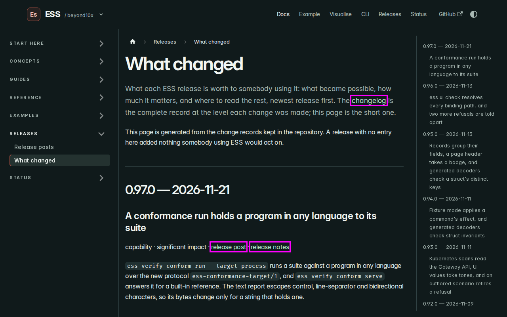
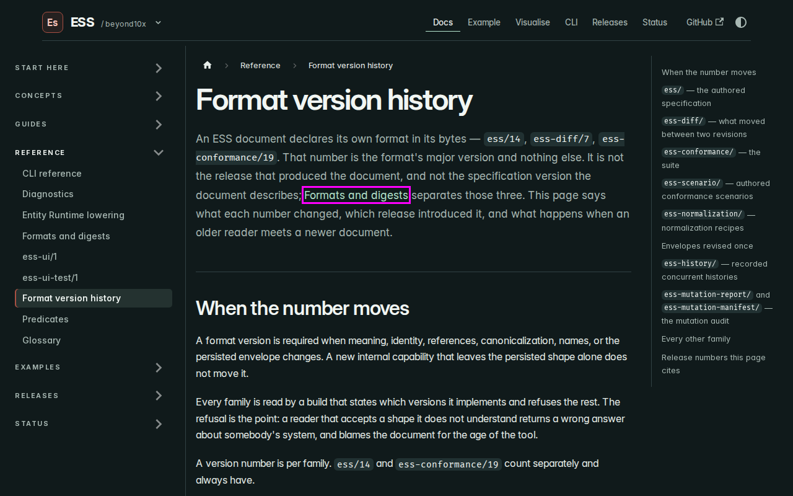
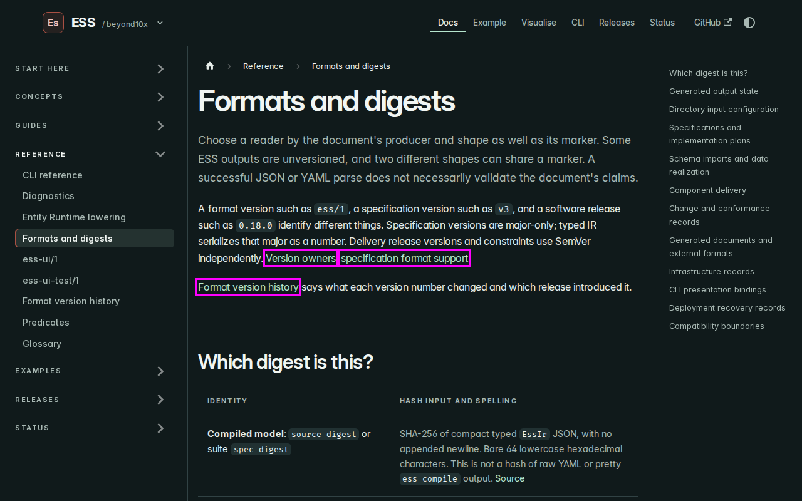
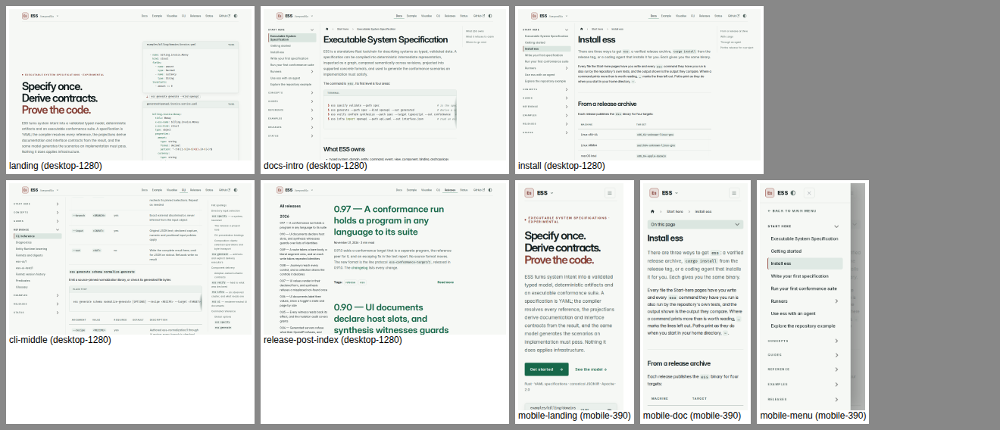
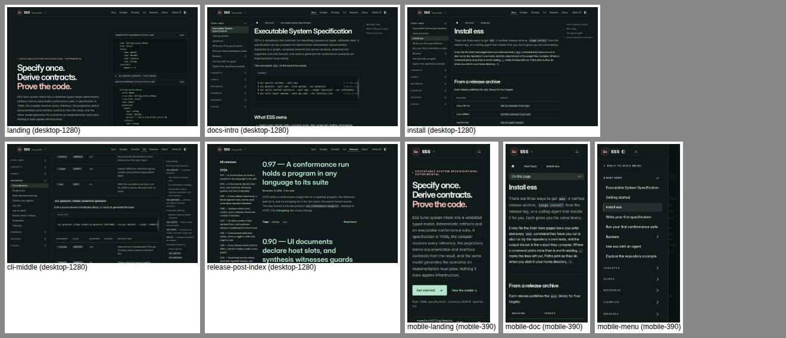

# UX round R-01: ESS documentation website

Date 2026-11-22, commit `6b580819542f`, 139 pages from the built sitemap. Gating viewports desktop-1280, mobile-390; measured only desktop-1440, desktop-1024, tablet-768; themes light and dark. Hermetic: every request off the local origin aborted.

Cards: anchors `first-conformance-run`, `install-linux-x86_64`; rotating `diagnostic-type-009`. No person ran them this round: the screen-only user played every task (L3), the questionnaire has no answers, and no session was recorded.

## Gates

| gate | result | counts |
| --- | --- | --- |
| 1 no horizontal overflow | pass | 0 of 139 pages; 0 with page scroll; 0 spills; configurations by viewport {} |
| 2 always visible | fail | 138 of 139 pages; search: missing ×548; docs sidebar: out of viewport ×136; blog sidebar: out of viewport ×135; blog sidebar: missing ×2 |
| 3 unmissable completion | pass | completion_miss 0, false_complete 0 |
| 4 screen-only user | pass | 18 of 18 task runs completed |
| 5 accessibility (axe) | fail | 2733 serious/critical nodes on 104 of 139 pages; label-content-name-mismatch (serious) 6 nodes on 2 pages; link-in-text-block (serious) 2702 nodes on 102 pages; color-contrast (serious) 22 nodes on 2 pages; nested-interactive (serious) 2 nodes on 1 pages; scrollable-region-focusable (serious) 1 nodes on 1 pages |
| 5 keyboard only | pass | 4 of 4 anchor runs completed |
| truncation | fail | 6 texts on 2 pages |
| reduced motion | pass | 0 pages animate or scroll smoothly under reduce |
| 6 cue truth | dropped | no guidance cue on a docs site |

Run time (workers 2, one run of l1, l2 and l3 together): L2 1641.3 s, L3 0 s, whole step 1699.9 s against the 120 s budget; run status timedout. Configurations measured: 548 of 556 (a test cut off at 60 s keeps what it measured).

That run was cut off, so 2 more run(s) measured the L2 tests it left unrun: 76 tests in 1698.8 s (timedout), 23 tests in 263.4 s (failed). L2 over all runs: 3662 s of wall time.

L1 and L3 above come from a run of their own (after a fix to the screen-only user): L1 7.1 s, L3 105.8 s, that run 118.4 s, status timedout. A second run measured the 6 task runs it left unrun in 31.8 s (passed).

Requests aborted off the local origin: none.

## Screen-only user (L3)

| task | viewport | mode | done | actions (bar) | steers | looks | glance p95 | time to act max | reading load max | note |
| --- | --- | --- | --- | --- | --- | --- | --- | --- | --- | --- |
| diagnostic-type-009 | desktop-1280 | pointer | yes | 6 (5) | 2 | 3 | 3 | 3 | 256 |  |
| diagnostic-type-009 | mobile-390 | pointer | yes | 7 (5) | 2 | 3 | 3 | 2 | 142 |  |
| ess-31-release | desktop-1280 | pointer | yes | 26 (6) | 1 | 3 | 3 | 2 | 291 |  |
| ess-31-release | mobile-390 | pointer | yes | 35 (6) | 4 | 3 | 3 | 3 | 142 |  |
| first-conformance-run | desktop-1280 | keyboard | yes | 23 (3) | 0 | 1 | 2 | 1 | 190 |  |
| first-conformance-run | desktop-1280 | pointer | yes | 2 (3) | 0 | 1 | 2 | 1 | 190 |  |
| first-conformance-run | mobile-390 | keyboard | yes | 26 (3) | 2 | 2 | 3 | 2 | 108 |  |
| first-conformance-run | mobile-390 | pointer | yes | 4 (3) | 2 | 2 | 3 | 2 | 108 |  |
| go-runner | desktop-1280 | pointer | yes | 2 (3) | 0 | 2 | 2 | 1 | 199 |  |
| go-runner | mobile-390 | pointer | yes | 3 (3) | 1 | 2 | 3 | 2 | 145 |  |
| install-linux-x86_64 | desktop-1280 | keyboard | yes | 21 (4) | 0 | 1 | 2 | 1 | 182 |  |
| install-linux-x86_64 | desktop-1280 | pointer | yes | 2 (4) | 0 | 1 | 2 | 1 | 190 |  |
| install-linux-x86_64 | mobile-390 | keyboard | yes | 24 (4) | 2 | 2 | 3 | 2 | 120 |  |
| install-linux-x86_64 | mobile-390 | pointer | yes | 4 (4) | 2 | 2 | 3 | 2 | 120 |  |
| limitations | desktop-1280 | pointer | yes | 2 (3) | 0 | 1 | 2 | 1 | 165 |  |
| limitations | mobile-390 | pointer | yes | 4 (3) | 2 | 2 | 3 | 2 | 106 |  |
| page-a-view | desktop-1280 | pointer | yes | 4 (5) | 0 | 3 | 2 | 1 | 230 |  |
| page-a-view | mobile-390 | pointer | yes | 10 (5) | 3 | 4 | 3 | 2 | 147 |  |
| target-process | desktop-1280 | pointer | yes | 6 (4) | 1 | 2 | 3 | 2 | 252 |  |
| target-process | mobile-390 | pointer | yes | 8 (4) | 2 | 2 | 3 | 2 | 122 |  |
| theme-dark-and-back | desktop-1280 | pointer | yes | 3 (2) | 0 | 0 | 1 | 1 | 215 |  |
| theme-dark-and-back | mobile-390 | pointer | yes | 4 (2) | 1 | 2 | 3 | 2 | 194 |  |

## Metrics against the baseline and the last round

All lower is better. The bar of a site key is 0 (a hard gate); a task's action bar is its card's expectation.

| scenario | key | this round | baseline | last round |
| --- | --- | --- | --- | --- |
| diagnostic-type-009/desktop-1280 | screen_only.actions | 6 | 6 | – |
| diagnostic-type-009/desktop-1280 | screen_only.looks | 3 | 3 | – |
| diagnostic-type-009/desktop-1280 | screen_only.steers | 2 | 2 | – |
| diagnostic-type-009/desktop-1280 | screen_only.time_to_act_steps.max | 3 | 3 | – |
| diagnostic-type-009/desktop-1280 | glance_cost.median | 2 | 2 | – |
| diagnostic-type-009/desktop-1280 | glance_cost.p95 | 3 | 3 | – |
| diagnostic-type-009/desktop-1280 | reading_load.max | 256 | 256 | – |
| diagnostic-type-009/desktop-1280 | reading_load.median | 202 | 202 | – |
| diagnostic-type-009/desktop-1280 | completion_miss | 0 | 0 | – |
| diagnostic-type-009/desktop-1280 | false_complete | 0 | 0 | – |
| diagnostic-type-009/mobile-390 | screen_only.actions | 7 | 7 | – |
| diagnostic-type-009/mobile-390 | screen_only.looks | 3 | 3 | – |
| diagnostic-type-009/mobile-390 | screen_only.steers | 2 | 2 | – |
| diagnostic-type-009/mobile-390 | screen_only.time_to_act_steps.max | 2 | 2 | – |
| diagnostic-type-009/mobile-390 | glance_cost.median | 3 | 3 | – |
| diagnostic-type-009/mobile-390 | glance_cost.p95 | 3 | 3 | – |
| diagnostic-type-009/mobile-390 | reading_load.max | 142 | 142 | – |
| diagnostic-type-009/mobile-390 | reading_load.median | 120 | 120 | – |
| diagnostic-type-009/mobile-390 | completion_miss | 0 | 0 | – |
| diagnostic-type-009/mobile-390 | false_complete | 0 | 0 | – |
| ess-31-release/desktop-1280 | screen_only.actions | 26 | 26 | – |
| ess-31-release/desktop-1280 | screen_only.looks | 3 | 3 | – |
| ess-31-release/desktop-1280 | screen_only.steers | 1 | 1 | – |
| ess-31-release/desktop-1280 | screen_only.time_to_act_steps.max | 2 | 2 | – |
| ess-31-release/desktop-1280 | glance_cost.median | 2 | 2 | – |
| ess-31-release/desktop-1280 | glance_cost.p95 | 3 | 3 | – |
| ess-31-release/desktop-1280 | reading_load.max | 291 | 291 | – |
| ess-31-release/desktop-1280 | reading_load.median | 202 | 202 | – |
| ess-31-release/desktop-1280 | completion_miss | 0 | 0 | – |
| ess-31-release/desktop-1280 | false_complete | 0 | 0 | – |
| ess-31-release/mobile-390 | screen_only.actions | 35 | 35 | – |
| ess-31-release/mobile-390 | screen_only.looks | 3 | 3 | – |
| ess-31-release/mobile-390 | screen_only.steers | 4 | 4 | – |
| ess-31-release/mobile-390 | screen_only.time_to_act_steps.max | 3 | 3 | – |
| ess-31-release/mobile-390 | glance_cost.median | 3 | 3 | – |
| ess-31-release/mobile-390 | glance_cost.p95 | 3 | 3 | – |
| ess-31-release/mobile-390 | reading_load.max | 142 | 142 | – |
| ess-31-release/mobile-390 | reading_load.median | 117 | 117 | – |
| ess-31-release/mobile-390 | completion_miss | 0 | 0 | – |
| ess-31-release/mobile-390 | false_complete | 0 | 0 | – |
| first-conformance-run/desktop-1280 | screen_only.actions | 2 | 2 | – |
| first-conformance-run/desktop-1280 | screen_only.looks | 1 | 1 | – |
| first-conformance-run/desktop-1280 | screen_only.steers | 0 | 0 | – |
| first-conformance-run/desktop-1280 | screen_only.time_to_act_steps.max | 1 | 1 | – |
| first-conformance-run/desktop-1280 | glance_cost.median | 1 | 1 | – |
| first-conformance-run/desktop-1280 | glance_cost.p95 | 2 | 2 | – |
| first-conformance-run/desktop-1280 | reading_load.max | 190 | 190 | – |
| first-conformance-run/desktop-1280 | reading_load.median | 189 | 189 | – |
| first-conformance-run/desktop-1280 | completion_miss | 0 | 0 | – |
| first-conformance-run/desktop-1280 | false_complete | 0 | 0 | – |
| first-conformance-run/desktop-1280/keyboard | screen_only.actions | 23 | 23 | – |
| first-conformance-run/desktop-1280/keyboard | screen_only.looks | 1 | 1 | – |
| first-conformance-run/desktop-1280/keyboard | screen_only.steers | 0 | 0 | – |
| first-conformance-run/desktop-1280/keyboard | screen_only.time_to_act_steps.max | 1 | 1 | – |
| first-conformance-run/desktop-1280/keyboard | glance_cost.median | 1 | 1 | – |
| first-conformance-run/desktop-1280/keyboard | glance_cost.p95 | 2 | 2 | – |
| first-conformance-run/desktop-1280/keyboard | reading_load.max | 190 | 190 | – |
| first-conformance-run/desktop-1280/keyboard | reading_load.median | 189 | 189 | – |
| first-conformance-run/desktop-1280/keyboard | completion_miss | 0 | 0 | – |
| first-conformance-run/desktop-1280/keyboard | false_complete | 0 | 0 | – |
| first-conformance-run/mobile-390 | screen_only.actions | 4 | 4 | – |
| first-conformance-run/mobile-390 | screen_only.looks | 2 | 2 | – |
| first-conformance-run/mobile-390 | screen_only.steers | 2 | 2 | – |
| first-conformance-run/mobile-390 | screen_only.time_to_act_steps.max | 2 | 2 | – |
| first-conformance-run/mobile-390 | glance_cost.median | 3 | 3 | – |
| first-conformance-run/mobile-390 | glance_cost.p95 | 3 | 3 | – |
| first-conformance-run/mobile-390 | reading_load.max | 108 | 108 | – |
| first-conformance-run/mobile-390 | reading_load.median | 99 | 99 | – |
| first-conformance-run/mobile-390 | completion_miss | 0 | 0 | – |
| first-conformance-run/mobile-390 | false_complete | 0 | 0 | – |
| first-conformance-run/mobile-390/keyboard | screen_only.actions | 26 | 26 | – |
| first-conformance-run/mobile-390/keyboard | screen_only.looks | 2 | 2 | – |
| first-conformance-run/mobile-390/keyboard | screen_only.steers | 2 | 2 | – |
| first-conformance-run/mobile-390/keyboard | screen_only.time_to_act_steps.max | 2 | 2 | – |
| first-conformance-run/mobile-390/keyboard | glance_cost.median | 3 | 3 | – |
| first-conformance-run/mobile-390/keyboard | glance_cost.p95 | 3 | 3 | – |
| first-conformance-run/mobile-390/keyboard | reading_load.max | 108 | 108 | – |
| first-conformance-run/mobile-390/keyboard | reading_load.median | 99 | 99 | – |
| first-conformance-run/mobile-390/keyboard | completion_miss | 0 | 0 | – |
| first-conformance-run/mobile-390/keyboard | false_complete | 0 | 0 | – |
| go-runner/desktop-1280 | screen_only.actions | 2 | 2 | – |
| go-runner/desktop-1280 | screen_only.looks | 2 | 2 | – |
| go-runner/desktop-1280 | screen_only.steers | 0 | 0 | – |
| go-runner/desktop-1280 | screen_only.time_to_act_steps.max | 1 | 1 | – |
| go-runner/desktop-1280 | glance_cost.median | 2 | 2 | – |
| go-runner/desktop-1280 | glance_cost.p95 | 2 | 2 | – |
| go-runner/desktop-1280 | reading_load.max | 199 | 199 | – |
| go-runner/desktop-1280 | reading_load.median | 190 | 190 | – |
| go-runner/desktop-1280 | completion_miss | 0 | 0 | – |
| go-runner/desktop-1280 | false_complete | 0 | 0 | – |
| go-runner/mobile-390 | screen_only.actions | 3 | 3 | – |
| go-runner/mobile-390 | screen_only.looks | 2 | 2 | – |
| go-runner/mobile-390 | screen_only.steers | 1 | 1 | – |
| go-runner/mobile-390 | screen_only.time_to_act_steps.max | 2 | 2 | – |
| go-runner/mobile-390 | glance_cost.median | 2 | 2 | – |
| go-runner/mobile-390 | glance_cost.p95 | 3 | 3 | – |
| go-runner/mobile-390 | reading_load.max | 145 | 145 | – |
| go-runner/mobile-390 | reading_load.median | 99 | 99 | – |
| go-runner/mobile-390 | completion_miss | 0 | 0 | – |
| go-runner/mobile-390 | false_complete | 0 | 0 | – |
| install-linux-x86_64/desktop-1280 | screen_only.actions | 2 | 2 | – |
| install-linux-x86_64/desktop-1280 | screen_only.looks | 1 | 1 | – |
| install-linux-x86_64/desktop-1280 | screen_only.steers | 0 | 0 | – |
| install-linux-x86_64/desktop-1280 | screen_only.time_to_act_steps.max | 1 | 1 | – |
| install-linux-x86_64/desktop-1280 | glance_cost.median | 1 | 1 | – |
| install-linux-x86_64/desktop-1280 | glance_cost.p95 | 2 | 2 | – |
| install-linux-x86_64/desktop-1280 | reading_load.max | 190 | 190 | – |
| install-linux-x86_64/desktop-1280 | reading_load.median | 182 | 182 | – |
| install-linux-x86_64/desktop-1280 | completion_miss | 0 | 0 | – |
| install-linux-x86_64/desktop-1280 | false_complete | 0 | 0 | – |
| install-linux-x86_64/desktop-1280/keyboard | screen_only.actions | 21 | 21 | – |
| install-linux-x86_64/desktop-1280/keyboard | screen_only.looks | 1 | 1 | – |
| install-linux-x86_64/desktop-1280/keyboard | screen_only.steers | 0 | 0 | – |
| install-linux-x86_64/desktop-1280/keyboard | screen_only.time_to_act_steps.max | 1 | 1 | – |
| install-linux-x86_64/desktop-1280/keyboard | glance_cost.median | 1 | 1 | – |
| install-linux-x86_64/desktop-1280/keyboard | glance_cost.p95 | 2 | 2 | – |
| install-linux-x86_64/desktop-1280/keyboard | reading_load.max | 182 | 182 | – |
| install-linux-x86_64/desktop-1280/keyboard | reading_load.median | 165 | 165 | – |
| install-linux-x86_64/desktop-1280/keyboard | completion_miss | 0 | 0 | – |
| install-linux-x86_64/desktop-1280/keyboard | false_complete | 0 | 0 | – |
| install-linux-x86_64/mobile-390 | screen_only.actions | 4 | 4 | – |
| install-linux-x86_64/mobile-390 | screen_only.looks | 2 | 2 | – |
| install-linux-x86_64/mobile-390 | screen_only.steers | 2 | 2 | – |
| install-linux-x86_64/mobile-390 | screen_only.time_to_act_steps.max | 2 | 2 | – |
| install-linux-x86_64/mobile-390 | glance_cost.median | 3 | 3 | – |
| install-linux-x86_64/mobile-390 | glance_cost.p95 | 3 | 3 | – |
| install-linux-x86_64/mobile-390 | reading_load.max | 120 | 120 | – |
| install-linux-x86_64/mobile-390 | reading_load.median | 99 | 99 | – |
| install-linux-x86_64/mobile-390 | completion_miss | 0 | 0 | – |
| install-linux-x86_64/mobile-390 | false_complete | 0 | 0 | – |
| install-linux-x86_64/mobile-390/keyboard | screen_only.actions | 24 | 24 | – |
| install-linux-x86_64/mobile-390/keyboard | screen_only.looks | 2 | 2 | – |
| install-linux-x86_64/mobile-390/keyboard | screen_only.steers | 2 | 2 | – |
| install-linux-x86_64/mobile-390/keyboard | screen_only.time_to_act_steps.max | 2 | 2 | – |
| install-linux-x86_64/mobile-390/keyboard | glance_cost.median | 3 | 3 | – |
| install-linux-x86_64/mobile-390/keyboard | glance_cost.p95 | 3 | 3 | – |
| install-linux-x86_64/mobile-390/keyboard | reading_load.max | 120 | 120 | – |
| install-linux-x86_64/mobile-390/keyboard | reading_load.median | 99 | 99 | – |
| install-linux-x86_64/mobile-390/keyboard | completion_miss | 0 | 0 | – |
| install-linux-x86_64/mobile-390/keyboard | false_complete | 0 | 0 | – |
| limitations/desktop-1280 | screen_only.actions | 2 | 2 | – |
| limitations/desktop-1280 | screen_only.looks | 1 | 1 | – |
| limitations/desktop-1280 | screen_only.steers | 0 | 0 | – |
| limitations/desktop-1280 | screen_only.time_to_act_steps.max | 1 | 1 | – |
| limitations/desktop-1280 | glance_cost.median | 1 | 1 | – |
| limitations/desktop-1280 | glance_cost.p95 | 2 | 2 | – |
| limitations/desktop-1280 | reading_load.max | 165 | 165 | – |
| limitations/desktop-1280 | reading_load.median | 164 | 164 | – |
| limitations/desktop-1280 | completion_miss | 0 | 0 | – |
| limitations/desktop-1280 | false_complete | 0 | 0 | – |
| limitations/mobile-390 | screen_only.actions | 4 | 4 | – |
| limitations/mobile-390 | screen_only.looks | 2 | 2 | – |
| limitations/mobile-390 | screen_only.steers | 2 | 2 | – |
| limitations/mobile-390 | screen_only.time_to_act_steps.max | 2 | 2 | – |
| limitations/mobile-390 | glance_cost.median | 3 | 3 | – |
| limitations/mobile-390 | glance_cost.p95 | 3 | 3 | – |
| limitations/mobile-390 | reading_load.max | 106 | 106 | – |
| limitations/mobile-390 | reading_load.median | 86 | 86 | – |
| limitations/mobile-390 | completion_miss | 0 | 0 | – |
| limitations/mobile-390 | false_complete | 0 | 0 | – |
| page-a-view/desktop-1280 | screen_only.actions | 4 | 4 | – |
| page-a-view/desktop-1280 | screen_only.looks | 3 | 3 | – |
| page-a-view/desktop-1280 | screen_only.steers | 0 | 0 | – |
| page-a-view/desktop-1280 | screen_only.time_to_act_steps.max | 1 | 1 | – |
| page-a-view/desktop-1280 | glance_cost.median | 2 | 2 | – |
| page-a-view/desktop-1280 | glance_cost.p95 | 2 | 2 | – |
| page-a-view/desktop-1280 | reading_load.max | 230 | 230 | – |
| page-a-view/desktop-1280 | reading_load.median | 214.5 | 214.5 | – |
| page-a-view/desktop-1280 | completion_miss | 0 | 0 | – |
| page-a-view/desktop-1280 | false_complete | 0 | 0 | – |
| page-a-view/mobile-390 | screen_only.actions | 10 | 10 | – |
| page-a-view/mobile-390 | screen_only.looks | 4 | 4 | – |
| page-a-view/mobile-390 | screen_only.steers | 3 | 3 | – |
| page-a-view/mobile-390 | screen_only.time_to_act_steps.max | 2 | 2 | – |
| page-a-view/mobile-390 | glance_cost.median | 3 | 3 | – |
| page-a-view/mobile-390 | glance_cost.p95 | 3 | 3 | – |
| page-a-view/mobile-390 | reading_load.max | 147 | 147 | – |
| page-a-view/mobile-390 | reading_load.median | 104.5 | 104.5 | – |
| page-a-view/mobile-390 | completion_miss | 0 | 0 | – |
| page-a-view/mobile-390 | false_complete | 0 | 0 | – |
| site/desktop-1280/dark | layout.page_scroll_pages | 0 | 0 | – |
| site/desktop-1280/dark | layout.spill_pages | 0 | 0 | – |
| site/desktop-1280/dark | layout.always_visible_pages | 135 | 135 | – |
| site/desktop-1280/dark | layout.truncated_texts | 0 | 0 | – |
| site/desktop-1280/dark | axe.serious_critical_nodes | 676 | 676 | – |
| site/desktop-1280/dark | axe.serious_critical_pages | 102 | 102 | – |
| site/desktop-1280/light | layout.page_scroll_pages | 0 | 0 | – |
| site/desktop-1280/light | layout.spill_pages | 0 | 0 | – |
| site/desktop-1280/light | layout.always_visible_pages | 138 | 138 | – |
| site/desktop-1280/light | layout.truncated_texts | 0 | 0 | – |
| site/desktop-1280/light | axe.serious_critical_nodes | 696 | 696 | – |
| site/desktop-1280/light | axe.serious_critical_pages | 104 | 104 | – |
| site/load | layout_shift.max | 0.018 | 0.018 | – |
| site/load | reduced_motion.pages | 0 | 0 | – |
| site/mobile-390/dark | layout.page_scroll_pages | 0 | 0 | – |
| site/mobile-390/dark | layout.spill_pages | 0 | 0 | – |
| site/mobile-390/dark | layout.always_visible_pages | 137 | 137 | – |
| site/mobile-390/dark | layout.truncated_texts | 3 | 3 | – |
| site/mobile-390/dark | axe.serious_critical_nodes | 670 | 670 | – |
| site/mobile-390/dark | axe.serious_critical_pages | 102 | 102 | – |
| site/mobile-390/light | layout.page_scroll_pages | 0 | 0 | – |
| site/mobile-390/light | layout.spill_pages | 0 | 0 | – |
| site/mobile-390/light | layout.always_visible_pages | 138 | 138 | – |
| site/mobile-390/light | layout.truncated_texts | 3 | 3 | – |
| site/mobile-390/light | axe.serious_critical_nodes | 691 | 691 | – |
| site/mobile-390/light | axe.serious_critical_pages | 104 | 104 | – |
| target-process/desktop-1280 | screen_only.actions | 6 | 6 | – |
| target-process/desktop-1280 | screen_only.looks | 2 | 2 | – |
| target-process/desktop-1280 | screen_only.steers | 1 | 1 | – |
| target-process/desktop-1280 | screen_only.time_to_act_steps.max | 2 | 2 | – |
| target-process/desktop-1280 | glance_cost.median | 2 | 2 | – |
| target-process/desktop-1280 | glance_cost.p95 | 3 | 3 | – |
| target-process/desktop-1280 | reading_load.max | 252 | 252 | – |
| target-process/desktop-1280 | reading_load.median | 213 | 213 | – |
| target-process/desktop-1280 | completion_miss | 0 | 0 | – |
| target-process/desktop-1280 | false_complete | 0 | 0 | – |
| target-process/mobile-390 | screen_only.actions | 8 | 8 | – |
| target-process/mobile-390 | screen_only.looks | 2 | 2 | – |
| target-process/mobile-390 | screen_only.steers | 2 | 2 | – |
| target-process/mobile-390 | screen_only.time_to_act_steps.max | 2 | 2 | – |
| target-process/mobile-390 | glance_cost.median | 3 | 3 | – |
| target-process/mobile-390 | glance_cost.p95 | 3 | 3 | – |
| target-process/mobile-390 | reading_load.max | 122 | 122 | – |
| target-process/mobile-390 | reading_load.median | 113 | 113 | – |
| target-process/mobile-390 | completion_miss | 0 | 0 | – |
| target-process/mobile-390 | false_complete | 0 | 0 | – |
| theme-dark-and-back/desktop-1280 | screen_only.actions | 3 | 3 | – |
| theme-dark-and-back/desktop-1280 | screen_only.looks | 0 | 0 | – |
| theme-dark-and-back/desktop-1280 | screen_only.steers | 0 | 0 | – |
| theme-dark-and-back/desktop-1280 | screen_only.time_to_act_steps.max | 1 | 1 | – |
| theme-dark-and-back/desktop-1280 | glance_cost.median | 1 | 1 | – |
| theme-dark-and-back/desktop-1280 | glance_cost.p95 | 1 | 1 | – |
| theme-dark-and-back/desktop-1280 | reading_load.max | 215 | 215 | – |
| theme-dark-and-back/desktop-1280 | reading_load.median | 215 | 215 | – |
| theme-dark-and-back/desktop-1280 | completion_miss | 0 | 0 | – |
| theme-dark-and-back/desktop-1280 | false_complete | 0 | 0 | – |
| theme-dark-and-back/mobile-390 | screen_only.actions | 4 | 4 | – |
| theme-dark-and-back/mobile-390 | screen_only.looks | 2 | 2 | – |
| theme-dark-and-back/mobile-390 | screen_only.steers | 1 | 1 | – |
| theme-dark-and-back/mobile-390 | screen_only.time_to_act_steps.max | 2 | 2 | – |
| theme-dark-and-back/mobile-390 | glance_cost.median | 2.5 | 2.5 | – |
| theme-dark-and-back/mobile-390 | glance_cost.p95 | 3 | 3 | – |
| theme-dark-and-back/mobile-390 | reading_load.max | 194 | 194 | – |
| theme-dark-and-back/mobile-390 | reading_load.median | 174.5 | 174.5 | – |
| theme-dark-and-back/mobile-390 | completion_miss | 0 | 0 | – |
| theme-dark-and-back/mobile-390 | false_complete | 0 | 0 | – |

## Measured-only viewports

| viewport | pages measured | pages with page scroll | pages with a spill | pages with an always-visible element out of view or covered | truncated texts |
| --- | --- | --- | --- | --- | --- |
| desktop-1440 | 13 | 0 | 0 | 12 | 0 |
| desktop-1024 | 13 | 0 | 0 | 12 | 0 |
| tablet-768 | 13 | 0 | 0 | 0 | 0 |

## Worst moments

- /ess/docs/releases/what-changed at desktop-1280, dark: axe link-in-text-block×156; always-visible: docs sidebar out of viewport at end (magenta outline: the first axe nodes)
  
- /ess/docs/reference/spec-versions at desktop-1280, dark: axe link-in-text-block×87; always-visible: docs sidebar out of viewport at end (magenta outline: the first axe nodes)
  
- /ess/docs/reference/formats at desktop-1280, dark: axe link-in-text-block×29; always-visible: docs sidebar out of viewport at end (magenta outline: the first axe nodes)
  

## Contact sheets

## Missing inputs

- L6 recorded live rounds and the questionnaire: no person took part in this round.
- Recordings (rrweb): none; the screen-only user's states are in `round.json` instead.
- L4 keyed replay, L5 discoverability probe, L7 review agents: run by the coordinator after this report.
- Baseline and last round: this is the first round, so both columns repeat or lack this round's values.
