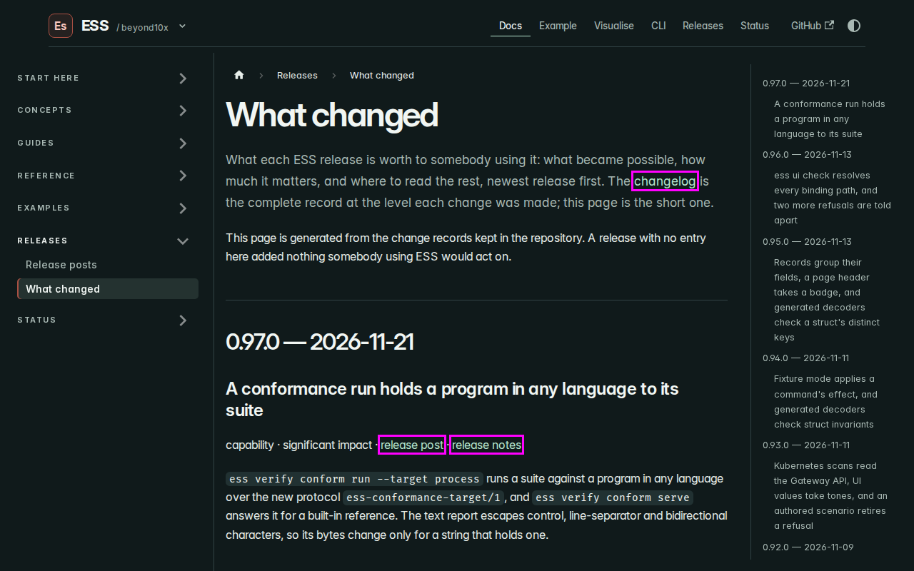
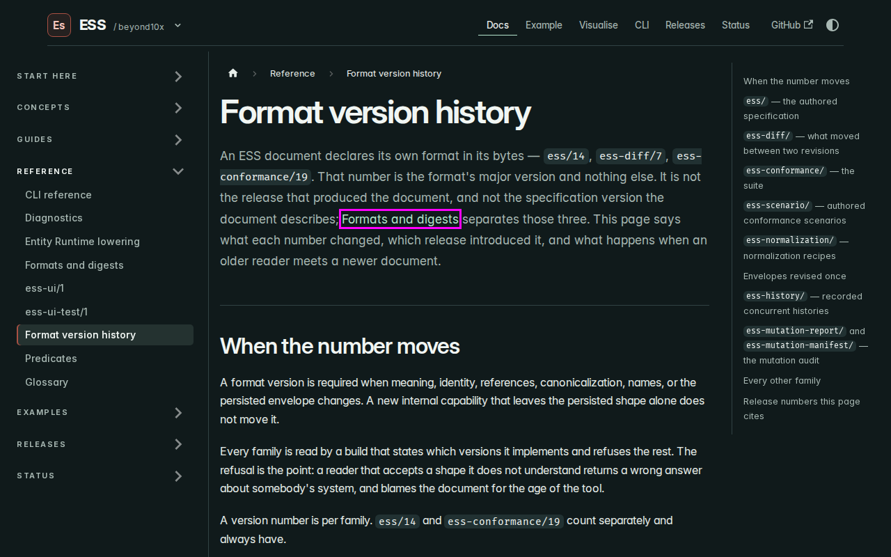
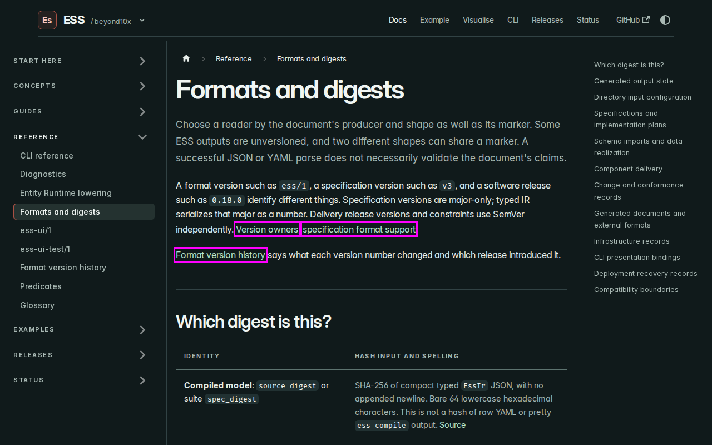
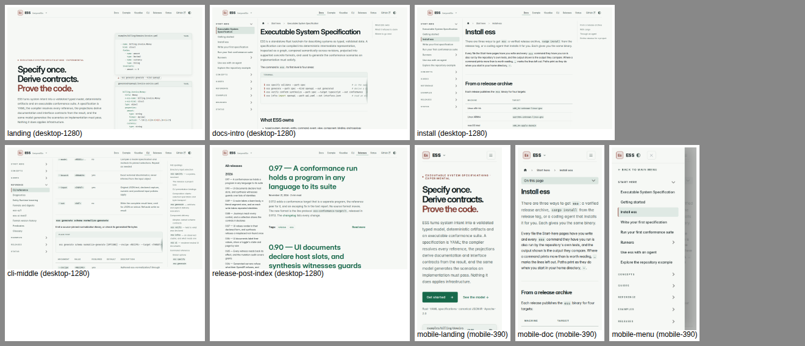
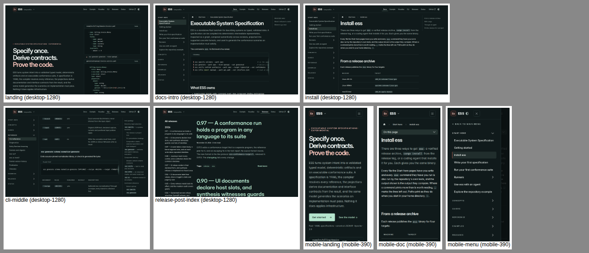

# UX round R-02: ESS documentation website

Date 2026-11-22. Engine: commit `21e8c21e0346`, digest `582d0200c3a3f7a9`. Gating viewports desktop-1280, mobile-390; measured only desktop-1440, desktop-1024, tablet-768; themes light and dark. Hermetic: every request off the local origin aborted.

Cards: anchors `first-conformance-run`, `install-linux-x86_64`; rotating `ess-31-release`. No person ran them this round: the screen-only user played every task (L3), the questionnaire has no answers, and no session was recorded.

## Coverage

| what | measured of expected |
| --- | --- |
| pages (every configuration measured) | 139 of 139 |
| page configurations (page × gating viewport × theme) | 556 of 556 |
|   desktop-1280/dark | 139 of 139 |
|   desktop-1280/light | 139 of 139 |
|   mobile-390/dark | 139 of 139 |
|   mobile-390/light | 139 of 139 |
| task runs | 22 of 22 |
| measured-only configurations | 417 of 417 |

Unmeasured: none.

## Gates

| gate | result | counts |
| --- | --- | --- |
| 1 no horizontal overflow | pass | 0 of 139 measured pages; 0 with page scroll; 0 spills |
| 2 always visible | fail | 2 of 139 measured pages; docs sidebar: out of viewport ×2; blog sidebar: out of viewport ×2; measured only, not gated: docs sidebar: out of viewport at end ×136; blog sidebar: out of viewport at end ×136 |
| 3 unmissable completion | pass | completion_miss 0, false_complete 0 |
| 4 screen-only user | fail | 18 of 18 pointer runs completed, 10 over the card's action limit |
| 5 accessibility (axe) | fail | 2732 serious/critical nodes on 105 of 139 measured pages; label-content-name-mismatch (serious) 4 nodes on 1 pages; link-in-text-block (serious) 2724 nodes on 103 pages; color-contrast (serious) 4 nodes on 1 pages |
| 5 keyboard only | pass | 4 of 4 keyboard runs completed |
| truncation | fail | 6 texts on 2 of 139 measured pages |
| reduced motion | pass | 0 of 139 measured pages animate or scroll smoothly under reduce |
| 6 cue truth | dropped | no guidance cue on a docs site |

Task runs over their card's limit:

- diagnostic-type-009/mobile-390: 7 actions, limit 5
- ess-31-release/desktop-1280: 25 actions, limit 6
- ess-31-release/mobile-390: 33 actions, limit 6
- first-conformance-run/mobile-390: 4 actions, limit 3
- limitations/mobile-390: 4 actions, limit 3
- page-a-view/mobile-390: 11 actions, limit 5
- target-process/desktop-1280: 5 actions, limit 4
- target-process/mobile-390: 12 actions, limit 4
- theme-dark-and-back/desktop-1280: 3 actions, limit 2
- theme-dark-and-back/mobile-390: 4 actions, limit 2

## Runs

Every run of this round, with its own time against the 120 s step budget of the gate lane. A project that ran no test is not listed.

| run | lane | engine | workers | wall s | status | projects (tests, wall s) | pages | task runs | unmeasured |
| --- | --- | --- | --- | --- | --- | --- | --- | --- | --- |
| slow-l2-1 | slow | 21e8c21e0346 582d0200c3a3f7a9 | 2 | 142.1 | failed | l2-1 47, 141.1 | 47 of 47 | 0 of 0 | 1 |
| slow-l2-2 | slow | 21e8c21e0346 582d0200c3a3f7a9 | 2 | 136.4 | failed | l2-2 47, 135.2 | 47 of 47 | 0 of 0 | 1 |
| slow-l2-3 | slow | 21e8c21e0346 582d0200c3a3f7a9 | 2 | 82.6 | failed | l2-3 46, 81.7 | 46 of 46 | 0 of 0 | 1 |
| slow-l2-4 | slow | 21e8c21e0346 582d0200c3a3f7a9 | 2 | 80.3 | failed | l2-4 46, 79.3 | 46 of 46 | 0 of 0 | 1 |
| slow-l2-5 | slow | 21e8c21e0346 582d0200c3a3f7a9 | 2 | 77.6 | failed | l2-5 46, 76.7 | 46 of 46 | 0 of 0 | 1 |
| slow-l2-6 | slow | 21e8c21e0346 582d0200c3a3f7a9 | 2 | 72.4 | failed | l2-6 46, 71.7 | 46 of 46 | 0 of 0 | 1 |
| slow-l3 | slow | 21e8c21e0346 582d0200c3a3f7a9 | 2 | 32.5 | failed | l3 22, 31.7 | 0 of 0 | 22 of 22 | 0 |
| slow-measured | slow | 21e8c21e0346 582d0200c3a3f7a9 | 2 | 153.3 | passed | measured 139, 152.5 | 0 of 0 | 0 of 0 | 0 |
| gate-7 | gate | 21e8c21e0346 582d0200c3a3f7a9 | 6 | 41.6 | failed | l1 29, 4.2; l2 19, 28.7; l3 8, 10.7 | 9 of 9 | 8 of 8 | 0 |
| gate-8 | gate | 21e8c21e0346 582d0200c3a3f7a9 | 6 | 29.1 | failed | l1 29, 3.9; l2 19, 17.3; l3 8, 9.4 | 9 of 9 | 8 of 8 | 0 |
| gate-9 | gate | 21e8c21e0346 582d0200c3a3f7a9 | 6 | 28.7 | failed | l1 29, 3.3; l2 19, 19; l3 8, 7.9 | 9 of 9 | 8 of 8 | 0 |

Ten slowest tests of the measurement:

| s | status | run | test |
| --- | --- | --- | --- |
| 20.3 | failed | slow-l2-2 | L2 /ess/docs/reference/predicates mobile-390 |
| 17.3 | failed | slow-l2-1 | L2 /ess/docs/reference/predicates desktop-1280 |
| 16.7 | failed | slow-l2-5 | L2 /ess/docs/reference/ess-ui desktop-1280 |
| 15.9 | failed | slow-l2-6 | L2 /ess/docs/reference/ess-ui mobile-390 |
| 12.2 | failed | slow-l2-1 | L2 /ess/docs/guides/verify/target-process desktop-1280 |
| 11.5 | passed | slow-l2-2 | L2 /ess/docs/reference/diagnostics mobile-390 |
| 11.3 | failed | slow-l2-2 | L2 /ess/docs/reference/ess-ui-test mobile-390 |
| 11 | passed | slow-l2-1 | L2 /ess/docs/reference/diagnostics desktop-1280 |
| 10.9 | failed | slow-l2-1 | L2 /ess/docs/reference/ess-ui-test desktop-1280 |
| 9.3 | failed | slow-l2-6 | L2 /ess/docs/reference/cli mobile-390 |

Where the slowest pages spent their time (ms per step; -1: the step did not end):

- /ess/docs/reference/predicates at mobile-390: goto 1416, hydrate 1347, theme light 137, layout light 385, visible light 1038, axe light 7181, theme dark 2563, layout dark 511, visible dark 627, axe dark 4920
- /ess/docs/reference/predicates at desktop-1280: goto 728, hydrate 1527, theme light 234, layout light 181, visible light 1451, axe light 5135, theme dark 2012, layout dark 275, visible dark 1493, axe dark 4052
- /ess/docs/reference/ess-ui at desktop-1280: goto 444, hydrate 1205, theme light 198, layout light 353, visible light 653, axe light 5245, theme dark 3366, layout dark 350, visible dark 960, axe dark 3827

## Screen-only user (L3)

| task | viewport | mode | done | actions (limit) | steers | looks | glance p95 | time to act max | reading load max | note |
| --- | --- | --- | --- | --- | --- | --- | --- | --- | --- | --- |
| diagnostic-type-009 | desktop-1280 | pointer | yes | 4 (5) | 2 | 3 | 3 | 3 | 256 |  |
| diagnostic-type-009 | mobile-390 | pointer | yes | 7 (5) | 5 | 3 | 3 | 5 | 142 |  |
| ess-31-release | desktop-1280 | pointer | yes | 25 (6) | 23 | 3 | 3 | 24 | 291 |  |
| ess-31-release | mobile-390 | pointer | yes | 33 (6) | 31 | 3 | 3 | 30 | 142 |  |
| first-conformance-run | desktop-1280 | pointer | yes | 2 (3) | 0 | 1 | 2 | 1 | 190 |  |
| first-conformance-run | desktop-1280 | keyboard | yes | 23 (–) | 0 | 2 | 3 | 1 | 190 |  |
| first-conformance-run | mobile-390 | pointer | yes | 4 (3) | 2 | 2 | 3 | 2 | 108 |  |
| first-conformance-run | mobile-390 | keyboard | yes | 130 (–) | 2 | 2 | 3 | 2 | 108 |  |
| go-runner | desktop-1280 | pointer | yes | 2 (3) | 0 | 2 | 2 | 1 | 199 |  |
| go-runner | mobile-390 | pointer | yes | 3 (3) | 1 | 2 | 3 | 2 | 145 |  |
| install-linux-x86_64 | desktop-1280 | pointer | yes | 2 (4) | 0 | 1 | 2 | 1 | 190 |  |
| install-linux-x86_64 | desktop-1280 | keyboard | yes | 21 (–) | 0 | 2 | 3 | 1 | 190 |  |
| install-linux-x86_64 | mobile-390 | pointer | yes | 4 (4) | 2 | 2 | 3 | 2 | 120 |  |
| install-linux-x86_64 | mobile-390 | keyboard | yes | 128 (–) | 2 | 2 | 3 | 2 | 120 |  |
| limitations | desktop-1280 | pointer | yes | 2 (3) | 0 | 1 | 2 | 1 | 165 |  |
| limitations | mobile-390 | pointer | yes | 4 (3) | 2 | 2 | 3 | 2 | 106 |  |
| page-a-view | desktop-1280 | pointer | yes | 4 (5) | 0 | 3 | 2 | 1 | 230 |  |
| page-a-view | mobile-390 | pointer | yes | 11 (5) | 8 | 4 | 3 | 6 | 147 |  |
| target-process | desktop-1280 | pointer | yes | 5 (4) | 3 | 2 | 3 | 4 | 252 |  |
| target-process | mobile-390 | pointer | yes | 12 (4) | 9 | 2 | 3 | 8 | 122 |  |
| theme-dark-and-back | desktop-1280 | pointer | yes | 3 (2) | 0 | 0 | 1 | 1 | 215 |  |
| theme-dark-and-back | mobile-390 | pointer | yes | 4 (2) | 1 | 2 | 3 | 2 | 194 |  |

## Metrics against the baseline and the last round

All lower is better. 556 page configurations and 22 task runs hold values; the page values are summed per viewport and theme here, every value is in round.json.

| scenario | key | this round | baseline | last round |
| --- | --- | --- | --- | --- |
| pages @desktop-1280/dark (sum) | layout.spills | 0 | – | – |
| pages @desktop-1280/dark (sum) | layout.truncated_texts | 0 | – | – |
| pages @desktop-1280/dark (sum) | always_visible.failures | 2 | – | – |
| pages @desktop-1280/dark (sum) | axe.serious_critical_rules | 104 | – | – |
| pages @desktop-1280/dark (sum) | axe.serious_critical_nodes | 685 | – | – |
| pages @desktop-1280/dark (sum) | layout_shift.load | 0.013 | – | – |
| pages @desktop-1280/dark (sum) | motion.running | 0 | – | – |
| pages @desktop-1280/light (sum) | layout.spills | 0 | – | – |
| pages @desktop-1280/light (sum) | layout.truncated_texts | 0 | – | – |
| pages @desktop-1280/light (sum) | always_visible.failures | 2 | – | – |
| pages @desktop-1280/light (sum) | axe.serious_critical_rules | 105 | – | – |
| pages @desktop-1280/light (sum) | axe.serious_critical_nodes | 687 | – | – |
| pages @mobile-390/dark (sum) | layout.spills | 0 | – | – |
| pages @mobile-390/dark (sum) | layout.truncated_texts | 3 | – | – |
| pages @mobile-390/dark (sum) | always_visible.failures | 0 | – | – |
| pages @mobile-390/dark (sum) | axe.serious_critical_rules | 104 | – | – |
| pages @mobile-390/dark (sum) | axe.serious_critical_nodes | 679 | – | – |
| pages @mobile-390/dark (sum) | layout_shift.load | 0.028 | – | – |
| pages @mobile-390/dark (sum) | motion.running | 0 | – | – |
| pages @mobile-390/light (sum) | layout.spills | 0 | – | – |
| pages @mobile-390/light (sum) | layout.truncated_texts | 3 | – | – |
| pages @mobile-390/light (sum) | always_visible.failures | 0 | – | – |
| pages @mobile-390/light (sum) | axe.serious_critical_rules | 105 | – | – |
| pages @mobile-390/light (sum) | axe.serious_critical_nodes | 681 | – | – |
| diagnostic-type-009/desktop-1280 | screen_only.actions | 4 | 6 | 6 |
| diagnostic-type-009/desktop-1280 | screen_only.looks | 3 | 3 | 3 |
| diagnostic-type-009/desktop-1280 | screen_only.steers | 2 | 2 | 2 |
| diagnostic-type-009/desktop-1280 | screen_only.time_to_act_steps.max | 3 | 3 | 3 |
| diagnostic-type-009/desktop-1280 | glance_cost.median | 2 | 2 | 2 |
| diagnostic-type-009/desktop-1280 | glance_cost.p95 | 3 | 3 | 3 |
| diagnostic-type-009/desktop-1280 | reading_load.max | 256 | 256 | 256 |
| diagnostic-type-009/desktop-1280 | reading_load.median | 202 | 202 | 202 |
| diagnostic-type-009/desktop-1280 | completion_miss | 0 | 0 | 0 |
| diagnostic-type-009/desktop-1280 | false_complete | 0 | 0 | 0 |
| diagnostic-type-009/mobile-390 | screen_only.actions | 7 | 7 | 7 |
| diagnostic-type-009/mobile-390 | screen_only.looks | 3 | 3 | 3 |
| diagnostic-type-009/mobile-390 | screen_only.steers | 5 | 2 | 2 |
| diagnostic-type-009/mobile-390 | screen_only.time_to_act_steps.max | 5 | 2 | 2 |
| diagnostic-type-009/mobile-390 | glance_cost.median | 3 | 3 | 3 |
| diagnostic-type-009/mobile-390 | glance_cost.p95 | 3 | 3 | 3 |
| diagnostic-type-009/mobile-390 | reading_load.max | 142 | 142 | 142 |
| diagnostic-type-009/mobile-390 | reading_load.median | 120 | 120 | 120 |
| diagnostic-type-009/mobile-390 | completion_miss | 0 | 0 | 0 |
| diagnostic-type-009/mobile-390 | false_complete | 0 | 0 | 0 |
| ess-31-release/desktop-1280 | screen_only.actions | 25 | 26 | 26 |
| ess-31-release/desktop-1280 | screen_only.looks | 3 | 3 | 3 |
| ess-31-release/desktop-1280 | screen_only.steers | 23 | 1 | 1 |
| ess-31-release/desktop-1280 | screen_only.time_to_act_steps.max | 24 | 2 | 2 |
| ess-31-release/desktop-1280 | glance_cost.median | 2 | 2 | 2 |
| ess-31-release/desktop-1280 | glance_cost.p95 | 3 | 3 | 3 |
| ess-31-release/desktop-1280 | reading_load.max | 291 | 291 | 291 |
| ess-31-release/desktop-1280 | reading_load.median | 202 | 202 | 202 |
| ess-31-release/desktop-1280 | completion_miss | 0 | 0 | 0 |
| ess-31-release/desktop-1280 | false_complete | 0 | 0 | 0 |
| ess-31-release/mobile-390 | screen_only.actions | 33 | 35 | 35 |
| ess-31-release/mobile-390 | screen_only.looks | 3 | 3 | 3 |
| ess-31-release/mobile-390 | screen_only.steers | 31 | 4 | 4 |
| ess-31-release/mobile-390 | screen_only.time_to_act_steps.max | 30 | 3 | 3 |
| ess-31-release/mobile-390 | glance_cost.median | 3 | 3 | 3 |
| ess-31-release/mobile-390 | glance_cost.p95 | 3 | 3 | 3 |
| ess-31-release/mobile-390 | reading_load.max | 142 | 142 | 142 |
| ess-31-release/mobile-390 | reading_load.median | 117 | 117 | 117 |
| ess-31-release/mobile-390 | completion_miss | 0 | 0 | 0 |
| ess-31-release/mobile-390 | false_complete | 0 | 0 | 0 |
| first-conformance-run/desktop-1280 | screen_only.actions | 2 | 2 | 2 |
| first-conformance-run/desktop-1280 | screen_only.looks | 1 | 1 | 1 |
| first-conformance-run/desktop-1280 | screen_only.steers | 0 | 0 | 0 |
| first-conformance-run/desktop-1280 | screen_only.time_to_act_steps.max | 1 | 1 | 1 |
| first-conformance-run/desktop-1280 | glance_cost.median | 1 | 1 | 1 |
| first-conformance-run/desktop-1280 | glance_cost.p95 | 2 | 2 | 2 |
| first-conformance-run/desktop-1280 | reading_load.max | 190 | 190 | 190 |
| first-conformance-run/desktop-1280 | reading_load.median | 189 | 189 | 189 |
| first-conformance-run/desktop-1280 | completion_miss | 0 | 0 | 0 |
| first-conformance-run/desktop-1280 | false_complete | 0 | 0 | 0 |
| first-conformance-run/desktop-1280/keyboard | screen_only.actions | 23 | 23 | 23 |
| first-conformance-run/desktop-1280/keyboard | screen_only.looks | 2 | 1 | 1 |
| first-conformance-run/desktop-1280/keyboard | screen_only.steers | 0 | 0 | 0 |
| first-conformance-run/desktop-1280/keyboard | screen_only.time_to_act_steps.max | 1 | 1 | 1 |
| first-conformance-run/desktop-1280/keyboard | glance_cost.median | 3 | 1 | 1 |
| first-conformance-run/desktop-1280/keyboard | glance_cost.p95 | 3 | 2 | 2 |
| first-conformance-run/desktop-1280/keyboard | reading_load.max | 190 | 190 | 190 |
| first-conformance-run/desktop-1280/keyboard | reading_load.median | 189 | 189 | 189 |
| first-conformance-run/desktop-1280/keyboard | completion_miss | 0 | 0 | 0 |
| first-conformance-run/desktop-1280/keyboard | false_complete | 0 | 0 | 0 |
| first-conformance-run/mobile-390 | screen_only.actions | 4 | 4 | 4 |
| first-conformance-run/mobile-390 | screen_only.looks | 2 | 2 | 2 |
| first-conformance-run/mobile-390 | screen_only.steers | 2 | 2 | 2 |
| first-conformance-run/mobile-390 | screen_only.time_to_act_steps.max | 2 | 2 | 2 |
| first-conformance-run/mobile-390 | glance_cost.median | 3 | 3 | 3 |
| first-conformance-run/mobile-390 | glance_cost.p95 | 3 | 3 | 3 |
| first-conformance-run/mobile-390 | reading_load.max | 108 | 108 | 108 |
| first-conformance-run/mobile-390 | reading_load.median | 99 | 99 | 99 |
| first-conformance-run/mobile-390 | completion_miss | 0 | 0 | 0 |
| first-conformance-run/mobile-390 | false_complete | 0 | 0 | 0 |
| first-conformance-run/mobile-390/keyboard | screen_only.actions | 130 | 26 | 26 |
| first-conformance-run/mobile-390/keyboard | screen_only.looks | 2 | 2 | 2 |
| first-conformance-run/mobile-390/keyboard | screen_only.steers | 2 | 2 | 2 |
| first-conformance-run/mobile-390/keyboard | screen_only.time_to_act_steps.max | 2 | 2 | 2 |
| first-conformance-run/mobile-390/keyboard | glance_cost.median | 3 | 3 | 3 |
| first-conformance-run/mobile-390/keyboard | glance_cost.p95 | 3 | 3 | 3 |
| first-conformance-run/mobile-390/keyboard | reading_load.max | 108 | 108 | 108 |
| first-conformance-run/mobile-390/keyboard | reading_load.median | 99 | 99 | 99 |
| first-conformance-run/mobile-390/keyboard | completion_miss | 0 | 0 | 0 |
| first-conformance-run/mobile-390/keyboard | false_complete | 0 | 0 | 0 |
| go-runner/desktop-1280 | screen_only.actions | 2 | 2 | 2 |
| go-runner/desktop-1280 | screen_only.looks | 2 | 2 | 2 |
| go-runner/desktop-1280 | screen_only.steers | 0 | 0 | 0 |
| go-runner/desktop-1280 | screen_only.time_to_act_steps.max | 1 | 1 | 1 |
| go-runner/desktop-1280 | glance_cost.median | 2 | 2 | 2 |
| go-runner/desktop-1280 | glance_cost.p95 | 2 | 2 | 2 |
| go-runner/desktop-1280 | reading_load.max | 199 | 199 | 199 |
| go-runner/desktop-1280 | reading_load.median | 190 | 190 | 190 |
| go-runner/desktop-1280 | completion_miss | 0 | 0 | 0 |
| go-runner/desktop-1280 | false_complete | 0 | 0 | 0 |
| go-runner/mobile-390 | screen_only.actions | 3 | 3 | 3 |
| go-runner/mobile-390 | screen_only.looks | 2 | 2 | 2 |
| go-runner/mobile-390 | screen_only.steers | 1 | 1 | 1 |
| go-runner/mobile-390 | screen_only.time_to_act_steps.max | 2 | 2 | 2 |
| go-runner/mobile-390 | glance_cost.median | 2 | 2 | 2 |
| go-runner/mobile-390 | glance_cost.p95 | 3 | 3 | 3 |
| go-runner/mobile-390 | reading_load.max | 145 | 145 | 145 |
| go-runner/mobile-390 | reading_load.median | 99 | 99 | 99 |
| go-runner/mobile-390 | completion_miss | 0 | 0 | 0 |
| go-runner/mobile-390 | false_complete | 0 | 0 | 0 |
| install-linux-x86_64/desktop-1280 | screen_only.actions | 2 | 2 | 2 |
| install-linux-x86_64/desktop-1280 | screen_only.looks | 1 | 1 | 1 |
| install-linux-x86_64/desktop-1280 | screen_only.steers | 0 | 0 | 0 |
| install-linux-x86_64/desktop-1280 | screen_only.time_to_act_steps.max | 1 | 1 | 1 |
| install-linux-x86_64/desktop-1280 | glance_cost.median | 1 | 1 | 1 |
| install-linux-x86_64/desktop-1280 | glance_cost.p95 | 2 | 2 | 2 |
| install-linux-x86_64/desktop-1280 | reading_load.max | 190 | 190 | 190 |
| install-linux-x86_64/desktop-1280 | reading_load.median | 182 | 182 | 182 |
| install-linux-x86_64/desktop-1280 | completion_miss | 0 | 0 | 0 |
| install-linux-x86_64/desktop-1280 | false_complete | 0 | 0 | 0 |
| install-linux-x86_64/desktop-1280/keyboard | screen_only.actions | 21 | 21 | 21 |
| install-linux-x86_64/desktop-1280/keyboard | screen_only.looks | 2 | 1 | 1 |
| install-linux-x86_64/desktop-1280/keyboard | screen_only.steers | 0 | 0 | 0 |
| install-linux-x86_64/desktop-1280/keyboard | screen_only.time_to_act_steps.max | 1 | 1 | 1 |
| install-linux-x86_64/desktop-1280/keyboard | glance_cost.median | 3 | 1 | 1 |
| install-linux-x86_64/desktop-1280/keyboard | glance_cost.p95 | 3 | 2 | 2 |
| install-linux-x86_64/desktop-1280/keyboard | reading_load.max | 190 | 182 | 182 |
| install-linux-x86_64/desktop-1280/keyboard | reading_load.median | 182 | 165 | 165 |
| install-linux-x86_64/desktop-1280/keyboard | completion_miss | 0 | 0 | 0 |
| install-linux-x86_64/desktop-1280/keyboard | false_complete | 0 | 0 | 0 |
| install-linux-x86_64/mobile-390 | screen_only.actions | 4 | 4 | 4 |
| install-linux-x86_64/mobile-390 | screen_only.looks | 2 | 2 | 2 |
| install-linux-x86_64/mobile-390 | screen_only.steers | 2 | 2 | 2 |
| install-linux-x86_64/mobile-390 | screen_only.time_to_act_steps.max | 2 | 2 | 2 |
| install-linux-x86_64/mobile-390 | glance_cost.median | 3 | 3 | 3 |
| install-linux-x86_64/mobile-390 | glance_cost.p95 | 3 | 3 | 3 |
| install-linux-x86_64/mobile-390 | reading_load.max | 120 | 120 | 120 |
| install-linux-x86_64/mobile-390 | reading_load.median | 99 | 99 | 99 |
| install-linux-x86_64/mobile-390 | completion_miss | 0 | 0 | 0 |
| install-linux-x86_64/mobile-390 | false_complete | 0 | 0 | 0 |
| install-linux-x86_64/mobile-390/keyboard | screen_only.actions | 128 | 24 | 24 |
| install-linux-x86_64/mobile-390/keyboard | screen_only.looks | 2 | 2 | 2 |
| install-linux-x86_64/mobile-390/keyboard | screen_only.steers | 2 | 2 | 2 |
| install-linux-x86_64/mobile-390/keyboard | screen_only.time_to_act_steps.max | 2 | 2 | 2 |
| install-linux-x86_64/mobile-390/keyboard | glance_cost.median | 3 | 3 | 3 |
| install-linux-x86_64/mobile-390/keyboard | glance_cost.p95 | 3 | 3 | 3 |
| install-linux-x86_64/mobile-390/keyboard | reading_load.max | 120 | 120 | 120 |
| install-linux-x86_64/mobile-390/keyboard | reading_load.median | 99 | 99 | 99 |
| install-linux-x86_64/mobile-390/keyboard | completion_miss | 0 | 0 | 0 |
| install-linux-x86_64/mobile-390/keyboard | false_complete | 0 | 0 | 0 |
| limitations/desktop-1280 | screen_only.actions | 2 | 2 | 2 |
| limitations/desktop-1280 | screen_only.looks | 1 | 1 | 1 |
| limitations/desktop-1280 | screen_only.steers | 0 | 0 | 0 |
| limitations/desktop-1280 | screen_only.time_to_act_steps.max | 1 | 1 | 1 |
| limitations/desktop-1280 | glance_cost.median | 1 | 1 | 1 |
| limitations/desktop-1280 | glance_cost.p95 | 2 | 2 | 2 |
| limitations/desktop-1280 | reading_load.max | 165 | 165 | 165 |
| limitations/desktop-1280 | reading_load.median | 164 | 164 | 164 |
| limitations/desktop-1280 | completion_miss | 0 | 0 | 0 |
| limitations/desktop-1280 | false_complete | 0 | 0 | 0 |
| limitations/mobile-390 | screen_only.actions | 4 | 4 | 4 |
| limitations/mobile-390 | screen_only.looks | 2 | 2 | 2 |
| limitations/mobile-390 | screen_only.steers | 2 | 2 | 2 |
| limitations/mobile-390 | screen_only.time_to_act_steps.max | 2 | 2 | 2 |
| limitations/mobile-390 | glance_cost.median | 3 | 3 | 3 |
| limitations/mobile-390 | glance_cost.p95 | 3 | 3 | 3 |
| limitations/mobile-390 | reading_load.max | 106 | 106 | 106 |
| limitations/mobile-390 | reading_load.median | 86 | 86 | 86 |
| limitations/mobile-390 | completion_miss | 0 | 0 | 0 |
| limitations/mobile-390 | false_complete | 0 | 0 | 0 |
| page-a-view/desktop-1280 | screen_only.actions | 4 | 4 | 4 |
| page-a-view/desktop-1280 | screen_only.looks | 3 | 3 | 3 |
| page-a-view/desktop-1280 | screen_only.steers | 0 | 0 | 0 |
| page-a-view/desktop-1280 | screen_only.time_to_act_steps.max | 1 | 1 | 1 |
| page-a-view/desktop-1280 | glance_cost.median | 2 | 2 | 2 |
| page-a-view/desktop-1280 | glance_cost.p95 | 2 | 2 | 2 |
| page-a-view/desktop-1280 | reading_load.max | 230 | 230 | 230 |
| page-a-view/desktop-1280 | reading_load.median | 214.5 | 214.5 | 214.5 |
| page-a-view/desktop-1280 | completion_miss | 0 | 0 | 0 |
| page-a-view/desktop-1280 | false_complete | 0 | 0 | 0 |
| page-a-view/mobile-390 | screen_only.actions | 11 | 10 | 10 |
| page-a-view/mobile-390 | screen_only.looks | 4 | 4 | 4 |
| page-a-view/mobile-390 | screen_only.steers | 8 | 3 | 3 |
| page-a-view/mobile-390 | screen_only.time_to_act_steps.max | 6 | 2 | 2 |
| page-a-view/mobile-390 | glance_cost.median | 3 | 3 | 3 |
| page-a-view/mobile-390 | glance_cost.p95 | 3 | 3 | 3 |
| page-a-view/mobile-390 | reading_load.max | 147 | 147 | 147 |
| page-a-view/mobile-390 | reading_load.median | 104.5 | 104.5 | 104.5 |
| page-a-view/mobile-390 | completion_miss | 0 | 0 | 0 |
| page-a-view/mobile-390 | false_complete | 0 | 0 | 0 |
| target-process/desktop-1280 | screen_only.actions | 5 | 6 | 6 |
| target-process/desktop-1280 | screen_only.looks | 2 | 2 | 2 |
| target-process/desktop-1280 | screen_only.steers | 3 | 1 | 1 |
| target-process/desktop-1280 | screen_only.time_to_act_steps.max | 4 | 2 | 2 |
| target-process/desktop-1280 | glance_cost.median | 2 | 2 | 2 |
| target-process/desktop-1280 | glance_cost.p95 | 3 | 3 | 3 |
| target-process/desktop-1280 | reading_load.max | 252 | 252 | 252 |
| target-process/desktop-1280 | reading_load.median | 213 | 213 | 213 |
| target-process/desktop-1280 | completion_miss | 0 | 0 | 0 |
| target-process/desktop-1280 | false_complete | 0 | 0 | 0 |
| target-process/mobile-390 | screen_only.actions | 12 | 8 | 8 |
| target-process/mobile-390 | screen_only.looks | 2 | 2 | 2 |
| target-process/mobile-390 | screen_only.steers | 9 | 2 | 2 |
| target-process/mobile-390 | screen_only.time_to_act_steps.max | 8 | 2 | 2 |
| target-process/mobile-390 | glance_cost.median | 3 | 3 | 3 |
| target-process/mobile-390 | glance_cost.p95 | 3 | 3 | 3 |
| target-process/mobile-390 | reading_load.max | 122 | 122 | 122 |
| target-process/mobile-390 | reading_load.median | 113 | 113 | 113 |
| target-process/mobile-390 | completion_miss | 0 | 0 | 0 |
| target-process/mobile-390 | false_complete | 0 | 0 | 0 |
| theme-dark-and-back/desktop-1280 | screen_only.actions | 3 | 3 | 3 |
| theme-dark-and-back/desktop-1280 | screen_only.looks | 0 | 0 | 0 |
| theme-dark-and-back/desktop-1280 | screen_only.steers | 0 | 0 | 0 |
| theme-dark-and-back/desktop-1280 | screen_only.time_to_act_steps.max | 1 | 1 | 1 |
| theme-dark-and-back/desktop-1280 | glance_cost.median | 1 | 1 | 1 |
| theme-dark-and-back/desktop-1280 | glance_cost.p95 | 1 | 1 | 1 |
| theme-dark-and-back/desktop-1280 | reading_load.max | 215 | 215 | 215 |
| theme-dark-and-back/desktop-1280 | reading_load.median | 215 | 215 | 215 |
| theme-dark-and-back/desktop-1280 | completion_miss | 0 | 0 | 0 |
| theme-dark-and-back/desktop-1280 | false_complete | 0 | 0 | 0 |
| theme-dark-and-back/mobile-390 | screen_only.actions | 4 | 4 | 4 |
| theme-dark-and-back/mobile-390 | screen_only.looks | 2 | 2 | 2 |
| theme-dark-and-back/mobile-390 | screen_only.steers | 1 | 1 | 1 |
| theme-dark-and-back/mobile-390 | screen_only.time_to_act_steps.max | 2 | 2 | 2 |
| theme-dark-and-back/mobile-390 | glance_cost.median | 2.5 | 2.5 | 2.5 |
| theme-dark-and-back/mobile-390 | glance_cost.p95 | 3 | 3 | 3 |
| theme-dark-and-back/mobile-390 | reading_load.max | 194 | 194 | 194 |
| theme-dark-and-back/mobile-390 | reading_load.median | 174.5 | 174.5 | 174.5 |
| theme-dark-and-back/mobile-390 | completion_miss | 0 | 0 | 0 |
| theme-dark-and-back/mobile-390 | false_complete | 0 | 0 | 0 |

## Measured-only viewports

| viewport | pages measured | with page scroll | with a spill | with an always-visible element out of view, covered or missing (in the states gate 2 gates) | truncated texts |
| --- | --- | --- | --- | --- | --- |
| desktop-1440 | 139 of 139 | 0 | 0 | 4 | 0 |
| desktop-1024 | 139 of 139 | 0 | 0 | 2 | 0 |
| tablet-768 | 139 of 139 | 0 | 0 | 0 | 0 |

## Worst moments

- /ess/docs/releases/what-changed at desktop-1280, dark: axe link-in-text-block×156 (magenta outline: the first axe nodes)
  
- /ess/docs/reference/spec-versions at desktop-1280, dark: axe link-in-text-block×87 (magenta outline: the first axe nodes)
  
- /ess/docs/reference/formats at desktop-1280, dark: axe link-in-text-block×29 (magenta outline: the first axe nodes)
  

## Contact sheets

## Missing inputs

- L6 recorded live rounds and the questionnaire: no person took part in this round.
- Recordings (rrweb): none; the screen-only user's states are in the runs' raw.json.
- L4 keyed replay, L5 discoverability probe, L7 review agents: run by the coordinator after this report.
