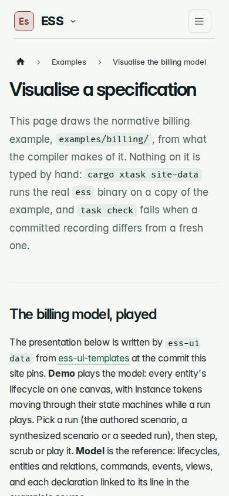
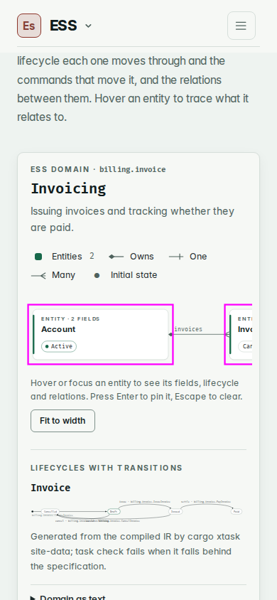
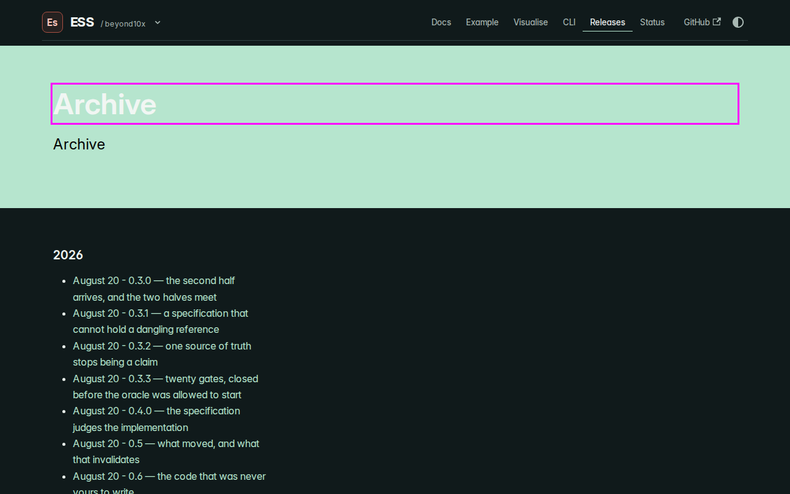
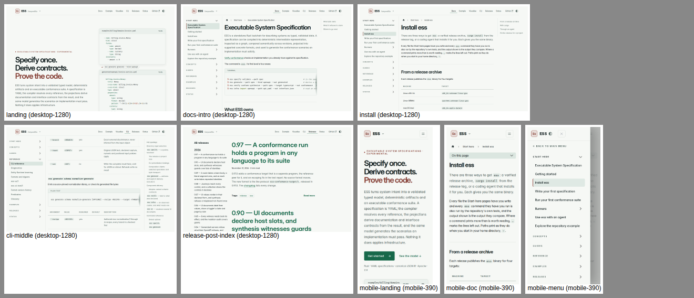
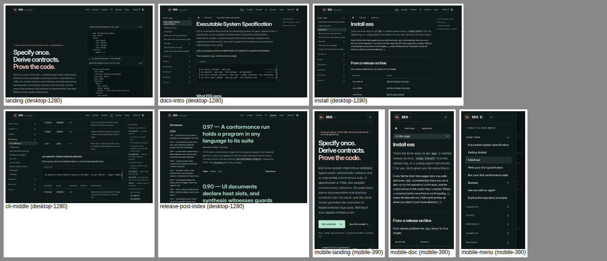

# UX round R-04: ESS documentation website

Date 2026-11-22. Engine: commit `0104a3a096d0`, digest `b4d04ba940322991`. Gating viewports desktop-1280, mobile-390; measured only desktop-1440, desktop-1024, tablet-768; themes light and dark. Hermetic: every request off the local origin aborted.

Cards: anchors `first-conformance-run`, `install-linux-x86_64`; rotating `limitations`. No person ran them this round: the screen-only user played every task (L3), the questionnaire has no answers, and no session was recorded.

## Coverage

| what | measured of expected |
| --- | --- |
| pages (every configuration measured) | 139 of 139 |
| page configurations (page × gating viewport × theme) | 556 of 556 |
|   desktop-1280/dark | 139 of 139 |
|   desktop-1280/light | 139 of 139 |
|   mobile-390/dark | 139 of 139 |
|   mobile-390/light | 139 of 139 |
| task runs | 22 of 22 |
| measured-only configurations | 417 of 417 |

Unmeasured: none.

## Gates

| gate | result | counts |
| --- | --- | --- |
| 1 no horizontal overflow | pass | 0 of 139 measured pages; 0 with page scroll; 0 spills |
| 2 always visible | pass | 0 of 139 measured pages; none; measured only, not gated: docs sidebar: out of viewport at end ×136; blog sidebar: out of viewport at end ×136 |
| 3 unmissable completion | pass | completion_miss 0, false_complete 0 |
| 4 screen-only user | fail | 18 of 18 pointer runs completed, 5 over the card's action limit |
| 5 accessibility (axe) | fail | 31 serious/critical nodes on 3 of 139 measured pages; label-content-name-mismatch (serious) 6 nodes on 2 pages; color-contrast (serious) 22 nodes on 2 pages; nested-interactive (serious) 2 nodes on 1 pages; scrollable-region-focusable (serious) 1 nodes on 1 pages |
| 5 keyboard only | pass | 4 of 4 keyboard runs completed |
| truncation | fail | 6 texts on 2 of 139 measured pages |
| reduced motion | pass | 0 of 139 measured pages animate or scroll smoothly under reduce |
| 6 cue truth | dropped | no guidance cue on a docs site |

Task runs over their card's limit:

- first-conformance-run/mobile-390: 4 actions, limit 3
- limitations/mobile-390: 4 actions, limit 3
- page-a-view/mobile-390: 11 actions, limit 5
- theme-dark-and-back/desktop-1280: 3 actions, limit 2
- theme-dark-and-back/mobile-390: 4 actions, limit 2

## Runs

Every run of this round, with its own time against the 120 s step budget of the gate lane. A project that ran no test is not listed. "Known" failures are the regression assets of open findings, expected to fail; "new" failures are every other failed test and every open finding's asset that passed: a run exits 1 on any new failure.

| run | lane | engine | workers | wall s | status | failed: known, new | projects (tests, wall s) | pages | task runs | unmeasured |
| --- | --- | --- | --- | --- | --- | --- | --- | --- | --- | --- |
| slow-l2-1 | slow | 0104a3a096d0 b4d04ba940322991 | 4 | 282.7 | failed | 3, 1 | l2-1 47, 280.3 | 46 of 47 | 0 of 0 | 2 |
| slow-l2-2 | slow | 0104a3a096d0 b4d04ba940322991 | 4 | 334.2 | failed | 3, 2 | l2-2 47, 326.8 | 45 of 47 | 0 of 0 | 4 |
| slow-l2-3 | slow | 0104a3a096d0 b4d04ba940322991 | 4 | 386.2 | failed | 0, 3 | l2-3 46, 380.6 | 43 of 46 | 0 of 0 | 4 |
| slow-l2-4 | slow | 0104a3a096d0 b4d04ba940322991 | 4 | 411.8 | failed | 0, 7 | l2-4 46, 405.6 | 39 of 46 | 0 of 0 | 8 |
| slow-l2-5 | slow | 0104a3a096d0 b4d04ba940322991 | 4 | 185.9 | failed | 0, 2 | l2-5 46, 183.8 | 44 of 46 | 0 of 0 | 4 |
| slow-l2-6 | slow | 0104a3a096d0 b4d04ba940322991 | 4 | 200.6 | failed | 0, 1 | l2-6 46, 197.6 | 45 of 46 | 0 of 0 | 2 |
| slow-l3 | slow | 0104a3a096d0 b4d04ba940322991 | 4 | 110.8 | passed | 5, 0 | l3 22, 104.2 | 0 of 0 | 22 of 22 | 0 |
| slow-measured | slow | 0104a3a096d0 b4d04ba940322991 | 4 | 123.9 | passed | 0, 0 | measured 139, 119.7 | 0 of 0 | 0 of 0 | 0 |
| slow-nested | slow | 0104a3a096d0 b4d04ba940322991 | 4 | 2.1 | passed | 0, 0 | nested 4, 1.7 | 0 of 0 | 0 of 0 | 0 |
| slow-rerun-a | slow | 0104a3a096d0 b4d04ba940322991 | 4 | 24.6 | passed | 0, 0 | l2-1 2, 6.4; l2-2 2, 6.3; l2-3 2, 6.1; l2-4 2, 5.8; l2-5 2, 12.9; l2-6 2, 11.4 | 6 of 6 | 0 of 0 | 1 |
| slow-rerun-b | slow | 0104a3a096d0 b4d04ba940322991 | 4 | 5.8 | passed | 0, 0 | l2-3 1, 2.9; l2-4 6, 5.3 | 7 of 7 | 0 of 0 | 1 |
| gate-9 | gate | 0104a3a096d0 b4d04ba940322991 | 4 | 118.2 | timedout | 5, 0 | l2 8, 49.2; l3 8, 60 | 3 of 8 | 8 of 8 | 18 |
| gate-10 | gate | 0104a3a096d0 b4d04ba940322991 | 4 | 117.7 | timedout | 8, 0 | l1 25, 17.2; l2 17, 71.5; l3 8, 32.9 | 8 of 8 | 8 of 8 | 0 |
| gate-11 | gate | 0104a3a096d0 b4d04ba940322991 | 4 | 118.3 | timedout | 6, 0 | l2 12, 86.3; l3 8, 30.3 | 5 of 8 | 8 of 8 | 10 |
| gate-12 | gate | 0104a3a096d0 b4d04ba940322991 | 4 | 35.1 | passed | 8, 0 | l1 43, 3.5; l2 17, 21.5; l3 8, 9.9 | 8 of 8 | 8 of 8 | 0 |
| gate-13 | gate | 0104a3a096d0 b4d04ba940322991 | 4 | 17.9 | passed | 8, 0 | l1 43, 3.6; l2 17, 7.9; l3 8, 6.8 | 8 of 8 | 8 of 8 | 0 |
| gate-14 | gate | 0104a3a096d0 b4d04ba940322991 | 4 | 51.5 | passed | 8, 0 | l1 43, 6; l2 17, 22.1; l3 8, 23.1 | 8 of 8 | 8 of 8 | 0 |

Ten slowest tests of the measurement:

| s | status | run | test |
| --- | --- | --- | --- |
| 60.5 | timedOut | slow-l2-4 | L2 /ess/docs/guides/specify/guards-and-predicates mobile-390 |
| 60.5 | timedOut | slow-l2-4 | L2 /ess/docs/reference/formats mobile-390 |
| 60.2 | timedOut | slow-l2-2 | L2 /ess/docs/reference/diagnostics mobile-390 |
| 60.2 | timedOut | slow-l2-4 | L2 /ess/docs/guides/synthesize mobile-390 |
| 60.1 | timedOut | slow-l2-2 | L2 /ess/docs/reference/predicates mobile-390 |
| 60.1 | timedOut | slow-l2-3 | L2 /ess/docs/reference/formats desktop-1280 |
| 60.1 | timedOut | slow-l2-3 | L2 /ess/docs/start/runners/go desktop-1280 |
| 60.1 | timedOut | slow-l2-4 | L2 /ess/docs/guides/verify/mutation-audit mobile-390 |
| 60.1 | timedOut | slow-l2-4 | L2 /ess/docs/guides/verify/author-scenarios mobile-390 |
| 60.1 | timedOut | slow-l2-4 | L2 /ess/docs/guides/specify/values-and-views mobile-390 |

Where the slowest pages spent their time (ms per step; -1: the step did not end):

- /ess/docs/guides/specify/bindings-and-components at mobile-390: goto 7234, hydrate 3202, theme light 2428, layout light 2303, visible light 4016, axe light 17933, theme dark 2265, layout dark 994, visible dark 6247, axe dark 10756
- /ess/releases/tags/release/page/2 at desktop-1280: goto 5275, hydrate 4440, theme light 101, layout light 47, visible light 10143, axe light 18208, theme dark 1947, layout dark 339, visible dark 6617, axe dark 9194
- /ess/docs/guides/http-routes at mobile-390: goto 5928, hydrate 7580, theme light 1629, layout light 2280, visible light 5002, axe light 10295, theme dark 3366, layout dark 768, visible dark 4660, axe dark 14293

## Screen-only user (L3)

| task | viewport | mode | done | actions (limit) | steers | looks | glance p95 | time to act max | reading load max | note |
| --- | --- | --- | --- | --- | --- | --- | --- | --- | --- | --- |
| diagnostic-type-009 | desktop-1280 | pointer | yes | 3 (5) | 0 | 3 | 2 | 1 | 265 |  |
| diagnostic-type-009 | mobile-390 | pointer | yes | 4 (5) | 1 | 3 | 3 | 2 | 165 |  |
| ess-31-release | desktop-1280 | pointer | yes | 3 (6) | 0 | 3 | 2 | 1 | 358 |  |
| ess-31-release | mobile-390 | pointer | yes | 5 (6) | 2 | 3 | 3 | 2 | 164 |  |
| first-conformance-run | desktop-1280 | pointer | yes | 2 (3) | 0 | 1 | 2 | 1 | 189 |  |
| first-conformance-run | desktop-1280 | keyboard | yes | 23 (–) | 0 | 2 | 3 | 1 | 189 |  |
| first-conformance-run | mobile-390 | pointer | yes | 4 (3) | 2 | 2 | 3 | 2 | 108 |  |
| first-conformance-run | mobile-390 | keyboard | yes | 131 (–) | 2 | 2 | 3 | 2 | 108 |  |
| go-runner | desktop-1280 | pointer | yes | 2 (3) | 0 | 2 | 2 | 1 | 198 |  |
| go-runner | mobile-390 | pointer | yes | 3 (3) | 1 | 2 | 3 | 2 | 140 |  |
| install-linux-x86_64 | desktop-1280 | pointer | yes | 2 (4) | 0 | 1 | 2 | 1 | 189 |  |
| install-linux-x86_64 | desktop-1280 | keyboard | yes | 21 (–) | 0 | 2 | 3 | 1 | 189 |  |
| install-linux-x86_64 | mobile-390 | pointer | yes | 4 (4) | 2 | 2 | 3 | 2 | 120 |  |
| install-linux-x86_64 | mobile-390 | keyboard | yes | 129 (–) | 2 | 2 | 3 | 2 | 120 |  |
| limitations | desktop-1280 | pointer | yes | 2 (3) | 0 | 1 | 2 | 1 | 165 |  |
| limitations | mobile-390 | pointer | yes | 4 (3) | 2 | 2 | 3 | 2 | 106 |  |
| page-a-view | desktop-1280 | pointer | yes | 4 (5) | 0 | 3 | 2 | 1 | 230 |  |
| page-a-view | mobile-390 | pointer | yes | 11 (5) | 8 | 4 | 3 | 6 | 142 |  |
| target-process | desktop-1280 | pointer | yes | 2 (4) | 0 | 1 | 2 | 1 | 252 |  |
| target-process | mobile-390 | pointer | yes | 4 (4) | 2 | 1 | 3 | 3 | 122 |  |
| theme-dark-and-back | desktop-1280 | pointer | yes | 3 (2) | 0 | 0 | 1 | 1 | 215 |  |
| theme-dark-and-back | mobile-390 | pointer | yes | 4 (2) | 1 | 2 | 3 | 2 | 194 |  |

## Metrics against the baseline and the last round

All lower is better. 556 page configurations and 22 task runs hold values; the page values are summed per viewport and theme here, every value is in round.json.

The baseline column is `baseline.json` as committed with this round, after the ratchet took the round in: UX ratchet baseline of the ESS documentation website, lower is better; written by cargo xtask ux-ratchet --update: lane full from round R-04, lane gate from round R-04; 3556 values in 578 scenario(s)

| scenario | key | this round | baseline | last round |
| --- | --- | --- | --- | --- |
| pages @desktop-1280/dark (sum) | layout.spills | 0 | 0 | 0 |
| pages @desktop-1280/dark (sum) | layout.truncated_texts | 0 | 0 | 0 |
| pages @desktop-1280/dark (sum) | always_visible.failures | 0 | 0 | 2 |
| pages @desktop-1280/dark (sum) | axe.serious_critical_rules | 2 | 2 | 2 |
| pages @desktop-1280/dark (sum) | axe.serious_critical_nodes | 2 | 2 | 2 |
| pages @desktop-1280/dark (sum) | layout_shift.load | 0.124 | 0.117 | 0.015 |
| pages @desktop-1280/dark (sum) | motion.running | 0 | 0 | 0 |
| pages @desktop-1280/light (sum) | layout.spills | 0 | 0 | 0 |
| pages @desktop-1280/light (sum) | layout.truncated_texts | 0 | 0 | 0 |
| pages @desktop-1280/light (sum) | always_visible.failures | 0 | 0 | 2 |
| pages @desktop-1280/light (sum) | axe.serious_critical_rules | 5 | 5 | 5 |
| pages @desktop-1280/light (sum) | axe.serious_critical_nodes | 13 | 13 | 13 |
| pages @mobile-390/dark (sum) | layout.spills | 0 | 0 | 0 |
| pages @mobile-390/dark (sum) | layout.truncated_texts | 3 | 3 | 3 |
| pages @mobile-390/dark (sum) | always_visible.failures | 0 | 0 | 0 |
| pages @mobile-390/dark (sum) | axe.serious_critical_rules | 2 | 2 | 2 |
| pages @mobile-390/dark (sum) | axe.serious_critical_nodes | 2 | 2 | 2 |
| pages @mobile-390/dark (sum) | layout_shift.load | 0.032 | 0.028 | 0.039 |
| pages @mobile-390/dark (sum) | motion.running | 0 | 0 | 0 |
| pages @mobile-390/light (sum) | layout.spills | 0 | 0 | 0 |
| pages @mobile-390/light (sum) | layout.truncated_texts | 3 | 3 | 3 |
| pages @mobile-390/light (sum) | always_visible.failures | 0 | 0 | 0 |
| pages @mobile-390/light (sum) | axe.serious_critical_rules | 6 | 6 | 6 |
| pages @mobile-390/light (sum) | axe.serious_critical_nodes | 14 | 14 | 14 |
| diagnostic-type-009/desktop-1280 | screen_only.actions | 3 | 3 | 4 |
| diagnostic-type-009/desktop-1280 | screen_only.looks | 3 | 3 | 3 |
| diagnostic-type-009/desktop-1280 | screen_only.steers | 0 | 0 | 2 |
| diagnostic-type-009/desktop-1280 | screen_only.time_to_act_steps.max | 1 | 1 | 3 |
| diagnostic-type-009/desktop-1280 | glance_cost.median | 2 | 2 | 2 |
| diagnostic-type-009/desktop-1280 | glance_cost.p95 | 2 | 2 | 3 |
| diagnostic-type-009/desktop-1280 | reading_load.max | 265 | 256 | 256 |
| diagnostic-type-009/desktop-1280 | reading_load.median | 201 | 201 | 202 |
| diagnostic-type-009/desktop-1280 | completion_miss | 0 | 0 | 0 |
| diagnostic-type-009/desktop-1280 | false_complete | 0 | 0 | 0 |
| diagnostic-type-009/mobile-390 | screen_only.actions | 4 | 4 | 7 |
| diagnostic-type-009/mobile-390 | screen_only.looks | 3 | 3 | 3 |
| diagnostic-type-009/mobile-390 | screen_only.steers | 1 | 1 | 5 |
| diagnostic-type-009/mobile-390 | screen_only.time_to_act_steps.max | 2 | 2 | 5 |
| diagnostic-type-009/mobile-390 | glance_cost.median | 2 | 2 | 3 |
| diagnostic-type-009/mobile-390 | glance_cost.p95 | 3 | 3 | 3 |
| diagnostic-type-009/mobile-390 | reading_load.max | 165 | 165 | 142 |
| diagnostic-type-009/mobile-390 | reading_load.median | 137 | 137 | 120 |
| diagnostic-type-009/mobile-390 | completion_miss | 0 | 0 | 0 |
| diagnostic-type-009/mobile-390 | false_complete | 0 | 0 | 0 |
| ess-31-release/desktop-1280 | screen_only.actions | 3 | 3 | 25 |
| ess-31-release/desktop-1280 | screen_only.looks | 3 | 3 | 3 |
| ess-31-release/desktop-1280 | screen_only.steers | 0 | 0 | 23 |
| ess-31-release/desktop-1280 | screen_only.time_to_act_steps.max | 1 | 1 | 24 |
| ess-31-release/desktop-1280 | glance_cost.median | 2 | 2 | 2 |
| ess-31-release/desktop-1280 | glance_cost.p95 | 2 | 2 | 3 |
| ess-31-release/desktop-1280 | reading_load.max | 358 | 358 | 291 |
| ess-31-release/desktop-1280 | reading_load.median | 201 | 201 | 202 |
| ess-31-release/desktop-1280 | completion_miss | 0 | 0 | 0 |
| ess-31-release/desktop-1280 | false_complete | 0 | 0 | 0 |
| ess-31-release/mobile-390 | screen_only.actions | 5 | 5 | 33 |
| ess-31-release/mobile-390 | screen_only.looks | 3 | 3 | 3 |
| ess-31-release/mobile-390 | screen_only.steers | 2 | 2 | 31 |
| ess-31-release/mobile-390 | screen_only.time_to_act_steps.max | 2 | 2 | 30 |
| ess-31-release/mobile-390 | glance_cost.median | 3 | 3 | 3 |
| ess-31-release/mobile-390 | glance_cost.p95 | 3 | 3 | 3 |
| ess-31-release/mobile-390 | reading_load.max | 164 | 164 | 142 |
| ess-31-release/mobile-390 | reading_load.median | 137 | 137 | 117 |
| ess-31-release/mobile-390 | completion_miss | 0 | 0 | 0 |
| ess-31-release/mobile-390 | false_complete | 0 | 0 | 0 |
| first-conformance-run/desktop-1280 | screen_only.actions | 2 | 2 | 2 |
| first-conformance-run/desktop-1280 | screen_only.looks | 1 | 1 | 1 |
| first-conformance-run/desktop-1280 | screen_only.steers | 0 | 0 | 0 |
| first-conformance-run/desktop-1280 | screen_only.time_to_act_steps.max | 1 | 1 | 1 |
| first-conformance-run/desktop-1280 | glance_cost.median | 1 | 1 | 1 |
| first-conformance-run/desktop-1280 | glance_cost.p95 | 2 | 2 | 2 |
| first-conformance-run/desktop-1280 | reading_load.max | 189 | 189 | 190 |
| first-conformance-run/desktop-1280 | reading_load.median | 189 | 189 | 189 |
| first-conformance-run/desktop-1280 | completion_miss | 0 | 0 | 0 |
| first-conformance-run/desktop-1280 | false_complete | 0 | 0 | 0 |
| first-conformance-run/desktop-1280/keyboard | screen_only.actions | 23 | 23 | 23 |
| first-conformance-run/desktop-1280/keyboard | screen_only.looks | 2 | 2 | 2 |
| first-conformance-run/desktop-1280/keyboard | screen_only.steers | 0 | 0 | 0 |
| first-conformance-run/desktop-1280/keyboard | screen_only.time_to_act_steps.max | 1 | 1 | 1 |
| first-conformance-run/desktop-1280/keyboard | glance_cost.median | 3 | 3 | 3 |
| first-conformance-run/desktop-1280/keyboard | glance_cost.p95 | 3 | 3 | 3 |
| first-conformance-run/desktop-1280/keyboard | reading_load.max | 189 | 189 | 190 |
| first-conformance-run/desktop-1280/keyboard | reading_load.median | 189 | 189 | 189 |
| first-conformance-run/desktop-1280/keyboard | completion_miss | 0 | 0 | 0 |
| first-conformance-run/desktop-1280/keyboard | false_complete | 0 | 0 | 0 |
| first-conformance-run/mobile-390 | screen_only.actions | 4 | 4 | 4 |
| first-conformance-run/mobile-390 | screen_only.looks | 2 | 2 | 2 |
| first-conformance-run/mobile-390 | screen_only.steers | 2 | 2 | 2 |
| first-conformance-run/mobile-390 | screen_only.time_to_act_steps.max | 2 | 2 | 2 |
| first-conformance-run/mobile-390 | glance_cost.median | 3 | 3 | 3 |
| first-conformance-run/mobile-390 | glance_cost.p95 | 3 | 3 | 3 |
| first-conformance-run/mobile-390 | reading_load.max | 108 | 108 | 108 |
| first-conformance-run/mobile-390 | reading_load.median | 94 | 94 | 99 |
| first-conformance-run/mobile-390 | completion_miss | 0 | 0 | 0 |
| first-conformance-run/mobile-390 | false_complete | 0 | 0 | 0 |
| first-conformance-run/mobile-390/keyboard | screen_only.actions | 131 | 131 | 130 |
| first-conformance-run/mobile-390/keyboard | screen_only.looks | 2 | 2 | 2 |
| first-conformance-run/mobile-390/keyboard | screen_only.steers | 2 | 2 | 2 |
| first-conformance-run/mobile-390/keyboard | screen_only.time_to_act_steps.max | 2 | 2 | 2 |
| first-conformance-run/mobile-390/keyboard | glance_cost.median | 3 | 3 | 3 |
| first-conformance-run/mobile-390/keyboard | glance_cost.p95 | 3 | 3 | 3 |
| first-conformance-run/mobile-390/keyboard | reading_load.max | 108 | 108 | 108 |
| first-conformance-run/mobile-390/keyboard | reading_load.median | 94 | 94 | 99 |
| first-conformance-run/mobile-390/keyboard | completion_miss | 0 | 0 | 0 |
| first-conformance-run/mobile-390/keyboard | false_complete | 0 | 0 | 0 |
| go-runner/desktop-1280 | screen_only.actions | 2 | 2 | 2 |
| go-runner/desktop-1280 | screen_only.looks | 2 | 2 | 2 |
| go-runner/desktop-1280 | screen_only.steers | 0 | 0 | 0 |
| go-runner/desktop-1280 | screen_only.time_to_act_steps.max | 1 | 1 | 1 |
| go-runner/desktop-1280 | glance_cost.median | 2 | 2 | 2 |
| go-runner/desktop-1280 | glance_cost.p95 | 2 | 2 | 2 |
| go-runner/desktop-1280 | reading_load.max | 198 | 198 | 199 |
| go-runner/desktop-1280 | reading_load.median | 189 | 189 | 190 |
| go-runner/desktop-1280 | completion_miss | 0 | 0 | 0 |
| go-runner/desktop-1280 | false_complete | 0 | 0 | 0 |
| go-runner/mobile-390 | screen_only.actions | 3 | 3 | 3 |
| go-runner/mobile-390 | screen_only.looks | 2 | 2 | 2 |
| go-runner/mobile-390 | screen_only.steers | 1 | 1 | 1 |
| go-runner/mobile-390 | screen_only.time_to_act_steps.max | 2 | 2 | 2 |
| go-runner/mobile-390 | glance_cost.median | 2 | 2 | 2 |
| go-runner/mobile-390 | glance_cost.p95 | 3 | 3 | 3 |
| go-runner/mobile-390 | reading_load.max | 140 | 140 | 145 |
| go-runner/mobile-390 | reading_load.median | 94 | 94 | 99 |
| go-runner/mobile-390 | completion_miss | 0 | 0 | 0 |
| go-runner/mobile-390 | false_complete | 0 | 0 | 0 |
| install-linux-x86_64/desktop-1280 | screen_only.actions | 2 | 2 | 2 |
| install-linux-x86_64/desktop-1280 | screen_only.looks | 1 | 1 | 1 |
| install-linux-x86_64/desktop-1280 | screen_only.steers | 0 | 0 | 0 |
| install-linux-x86_64/desktop-1280 | screen_only.time_to_act_steps.max | 1 | 1 | 1 |
| install-linux-x86_64/desktop-1280 | glance_cost.median | 1 | 1 | 1 |
| install-linux-x86_64/desktop-1280 | glance_cost.p95 | 2 | 2 | 2 |
| install-linux-x86_64/desktop-1280 | reading_load.max | 189 | 189 | 190 |
| install-linux-x86_64/desktop-1280 | reading_load.median | 182 | 182 | 182 |
| install-linux-x86_64/desktop-1280 | completion_miss | 0 | 0 | 0 |
| install-linux-x86_64/desktop-1280 | false_complete | 0 | 0 | 0 |
| install-linux-x86_64/desktop-1280/keyboard | screen_only.actions | 21 | 21 | 21 |
| install-linux-x86_64/desktop-1280/keyboard | screen_only.looks | 2 | 2 | 2 |
| install-linux-x86_64/desktop-1280/keyboard | screen_only.steers | 0 | 0 | 0 |
| install-linux-x86_64/desktop-1280/keyboard | screen_only.time_to_act_steps.max | 1 | 1 | 1 |
| install-linux-x86_64/desktop-1280/keyboard | glance_cost.median | 3 | 3 | 3 |
| install-linux-x86_64/desktop-1280/keyboard | glance_cost.p95 | 3 | 3 | 3 |
| install-linux-x86_64/desktop-1280/keyboard | reading_load.max | 189 | 182 | 190 |
| install-linux-x86_64/desktop-1280/keyboard | reading_load.median | 182 | 182 | 182 |
| install-linux-x86_64/desktop-1280/keyboard | completion_miss | 0 | 0 | 0 |
| install-linux-x86_64/desktop-1280/keyboard | false_complete | 0 | 0 | 0 |
| install-linux-x86_64/mobile-390 | screen_only.actions | 4 | 4 | 4 |
| install-linux-x86_64/mobile-390 | screen_only.looks | 2 | 2 | 2 |
| install-linux-x86_64/mobile-390 | screen_only.steers | 2 | 2 | 2 |
| install-linux-x86_64/mobile-390 | screen_only.time_to_act_steps.max | 2 | 2 | 2 |
| install-linux-x86_64/mobile-390 | glance_cost.median | 3 | 3 | 3 |
| install-linux-x86_64/mobile-390 | glance_cost.p95 | 3 | 3 | 3 |
| install-linux-x86_64/mobile-390 | reading_load.max | 120 | 120 | 120 |
| install-linux-x86_64/mobile-390 | reading_load.median | 94 | 94 | 99 |
| install-linux-x86_64/mobile-390 | completion_miss | 0 | 0 | 0 |
| install-linux-x86_64/mobile-390 | false_complete | 0 | 0 | 0 |
| install-linux-x86_64/mobile-390/keyboard | screen_only.actions | 129 | 129 | 128 |
| install-linux-x86_64/mobile-390/keyboard | screen_only.looks | 2 | 2 | 2 |
| install-linux-x86_64/mobile-390/keyboard | screen_only.steers | 2 | 2 | 2 |
| install-linux-x86_64/mobile-390/keyboard | screen_only.time_to_act_steps.max | 2 | 2 | 2 |
| install-linux-x86_64/mobile-390/keyboard | glance_cost.median | 3 | 3 | 3 |
| install-linux-x86_64/mobile-390/keyboard | glance_cost.p95 | 3 | 3 | 3 |
| install-linux-x86_64/mobile-390/keyboard | reading_load.max | 120 | 120 | 120 |
| install-linux-x86_64/mobile-390/keyboard | reading_load.median | 94 | 94 | 99 |
| install-linux-x86_64/mobile-390/keyboard | completion_miss | 0 | 0 | 0 |
| install-linux-x86_64/mobile-390/keyboard | false_complete | 0 | 0 | 0 |
| limitations/desktop-1280 | screen_only.actions | 2 | 2 | 2 |
| limitations/desktop-1280 | screen_only.looks | 1 | 1 | 1 |
| limitations/desktop-1280 | screen_only.steers | 0 | 0 | 0 |
| limitations/desktop-1280 | screen_only.time_to_act_steps.max | 1 | 1 | 1 |
| limitations/desktop-1280 | glance_cost.median | 1 | 1 | 1 |
| limitations/desktop-1280 | glance_cost.p95 | 2 | 2 | 2 |
| limitations/desktop-1280 | reading_load.max | 165 | 165 | 165 |
| limitations/desktop-1280 | reading_load.median | 164 | 164 | 164 |
| limitations/desktop-1280 | completion_miss | 0 | 0 | 0 |
| limitations/desktop-1280 | false_complete | 0 | 0 | 0 |
| limitations/mobile-390 | screen_only.actions | 4 | 4 | 4 |
| limitations/mobile-390 | screen_only.looks | 2 | 2 | 2 |
| limitations/mobile-390 | screen_only.steers | 2 | 2 | 2 |
| limitations/mobile-390 | screen_only.time_to_act_steps.max | 2 | 2 | 2 |
| limitations/mobile-390 | glance_cost.median | 3 | 3 | 3 |
| limitations/mobile-390 | glance_cost.p95 | 3 | 3 | 3 |
| limitations/mobile-390 | reading_load.max | 106 | 106 | 106 |
| limitations/mobile-390 | reading_load.median | 86 | 86 | 86 |
| limitations/mobile-390 | completion_miss | 0 | 0 | 0 |
| limitations/mobile-390 | false_complete | 0 | 0 | 0 |
| page-a-view/desktop-1280 | screen_only.actions | 4 | 4 | 4 |
| page-a-view/desktop-1280 | screen_only.looks | 3 | 3 | 3 |
| page-a-view/desktop-1280 | screen_only.steers | 0 | 0 | 0 |
| page-a-view/desktop-1280 | screen_only.time_to_act_steps.max | 1 | 1 | 1 |
| page-a-view/desktop-1280 | glance_cost.median | 2 | 2 | 2 |
| page-a-view/desktop-1280 | glance_cost.p95 | 2 | 2 | 2 |
| page-a-view/desktop-1280 | reading_load.max | 230 | 230 | 230 |
| page-a-view/desktop-1280 | reading_load.median | 214 | 214 | 214.5 |
| page-a-view/desktop-1280 | completion_miss | 0 | 0 | 0 |
| page-a-view/desktop-1280 | false_complete | 0 | 0 | 0 |
| page-a-view/mobile-390 | screen_only.actions | 11 | 11 | 11 |
| page-a-view/mobile-390 | screen_only.looks | 4 | 4 | 4 |
| page-a-view/mobile-390 | screen_only.steers | 8 | 8 | 8 |
| page-a-view/mobile-390 | screen_only.time_to_act_steps.max | 6 | 6 | 6 |
| page-a-view/mobile-390 | glance_cost.median | 3 | 3 | 3 |
| page-a-view/mobile-390 | glance_cost.p95 | 3 | 3 | 3 |
| page-a-view/mobile-390 | reading_load.max | 142 | 142 | 147 |
| page-a-view/mobile-390 | reading_load.median | 102 | 102 | 104.5 |
| page-a-view/mobile-390 | completion_miss | 0 | 0 | 0 |
| page-a-view/mobile-390 | false_complete | 0 | 0 | 0 |
| target-process/desktop-1280 | screen_only.actions | 2 | 2 | 5 |
| target-process/desktop-1280 | screen_only.looks | 1 | 1 | 2 |
| target-process/desktop-1280 | screen_only.steers | 0 | 0 | 3 |
| target-process/desktop-1280 | screen_only.time_to_act_steps.max | 1 | 1 | 4 |
| target-process/desktop-1280 | glance_cost.median | 1 | 1 | 2 |
| target-process/desktop-1280 | glance_cost.p95 | 2 | 2 | 3 |
| target-process/desktop-1280 | reading_load.max | 252 | 252 | 252 |
| target-process/desktop-1280 | reading_load.median | 213 | 213 | 213 |
| target-process/desktop-1280 | completion_miss | 0 | 0 | 0 |
| target-process/desktop-1280 | false_complete | 0 | 0 | 0 |
| target-process/mobile-390 | screen_only.actions | 4 | 4 | 12 |
| target-process/mobile-390 | screen_only.looks | 1 | 1 | 2 |
| target-process/mobile-390 | screen_only.steers | 2 | 2 | 9 |
| target-process/mobile-390 | screen_only.time_to_act_steps.max | 3 | 3 | 8 |
| target-process/mobile-390 | glance_cost.median | 1 | 1 | 3 |
| target-process/mobile-390 | glance_cost.p95 | 3 | 3 | 3 |
| target-process/mobile-390 | reading_load.max | 122 | 122 | 122 |
| target-process/mobile-390 | reading_load.median | 113 | 113 | 113 |
| target-process/mobile-390 | completion_miss | 0 | 0 | 0 |
| target-process/mobile-390 | false_complete | 0 | 0 | 0 |
| theme-dark-and-back/desktop-1280 | screen_only.actions | 3 | 3 | 3 |
| theme-dark-and-back/desktop-1280 | screen_only.looks | 0 | 0 | 0 |
| theme-dark-and-back/desktop-1280 | screen_only.steers | 0 | 0 | 0 |
| theme-dark-and-back/desktop-1280 | screen_only.time_to_act_steps.max | 1 | 1 | 1 |
| theme-dark-and-back/desktop-1280 | glance_cost.median | 1 | 1 | 1 |
| theme-dark-and-back/desktop-1280 | glance_cost.p95 | 1 | 1 | 1 |
| theme-dark-and-back/desktop-1280 | reading_load.max | 215 | 215 | 215 |
| theme-dark-and-back/desktop-1280 | reading_load.median | 215 | 215 | 215 |
| theme-dark-and-back/desktop-1280 | completion_miss | 0 | 0 | 0 |
| theme-dark-and-back/desktop-1280 | false_complete | 0 | 0 | 0 |
| theme-dark-and-back/mobile-390 | screen_only.actions | 4 | 4 | 4 |
| theme-dark-and-back/mobile-390 | screen_only.looks | 2 | 2 | 2 |
| theme-dark-and-back/mobile-390 | screen_only.steers | 1 | 1 | 1 |
| theme-dark-and-back/mobile-390 | screen_only.time_to_act_steps.max | 2 | 2 | 2 |
| theme-dark-and-back/mobile-390 | glance_cost.median | 2.5 | 2.5 | 2.5 |
| theme-dark-and-back/mobile-390 | glance_cost.p95 | 3 | 3 | 3 |
| theme-dark-and-back/mobile-390 | reading_load.max | 194 | 194 | 194 |
| theme-dark-and-back/mobile-390 | reading_load.median | 174.5 | 174.5 | 174.5 |
| theme-dark-and-back/mobile-390 | completion_miss | 0 | 0 | 0 |
| theme-dark-and-back/mobile-390 | false_complete | 0 | 0 | 0 |

## Measured-only viewports

| viewport | pages measured | with page scroll | with a spill | with an always-visible element out of view, covered or missing (in the states gate 2 gates) | truncated texts |
| --- | --- | --- | --- | --- | --- |
| desktop-1440 | 139 of 139 | 0 | 0 | 1 | 0 |
| desktop-1024 | 139 of 139 | 0 | 0 | 0 | 0 |
| tablet-768 | 139 of 139 | 0 | 0 | 0 | 0 |

## Worst moments

- /ess/docs/visualise at mobile-390, light: axe color-contrast×8, label-content-name-mismatch×1, nested-interactive×1, scrollable-region-focusable×1; 1 truncated (magenta outline: the first axe nodes)
  
- /ess/ at mobile-390, light: axe label-content-name-mismatch×2; 2 truncated (magenta outline: the first axe nodes)
  
- /ess/releases/archive at desktop-1280, dark: axe color-contrast×1 (magenta outline: the first axe nodes)
  

## Contact sheets

## Missing inputs

- L6 recorded live rounds and the questionnaire: no person took part in this round.
- Recordings (rrweb): none; the screen-only user's states are in the runs' raw.json.
- L4 keyed replay, L5 discoverability probe, L7 review agents: run by the coordinator after this report.

## Notes of the round (written by hand in notes.md; every number is one of round.json)

- The host's load decided this round's times. `gate-9`, `gate-10` and `gate-11` ran at a
  1-minute load of 115.29 to 140.34 and were cut at the 120 s bound (118.2, 117.7 and 118.3 s of
  wall time, status `timedout`), with no new failure. `gate-12`, `gate-13` and `gate-14` ran at
  20.01 to 71.61 and passed in 35.1, 17.9 and 51.5 s. UXF-025 stays open: the gate does not hold
  its bound on a loaded host.
- The slow lane's six L2 jobs ran at 117.83 to 170.96; 16 of their tests did not pass (15 timed
  out, 1 failed: `runs[].timing.unexpected`) and ran again, with 3 more, 19 tests in all, in
  `slow-rerun-a` and `slow-rerun-b` at 54.25 to 68.73 and passed (24.6 and 5.8 s of wall time).
- Gate 4 lists 5 runs over their card's limit. `ess-31-release`, `diagnostic-type-009` and
  `target-process` left the list (changes 4 and 5); the phone navigation of
  `first-conformance-run`, `limitations` and `page-a-view` is the shared theme's (UXF-013).
- Gate 2 passes: the sidebar stays in view in the middle state on short pages (UXF-022).
- Nine values are worse than the baseline and carry `R-04-worse` (`decision.md`): the reading
  load of the two index pages, one keyboard action on two phone cards, and one layout shift each
  on two pages measured under load. Against R-03's round values 13 are higher: the 9, and 4 more
  inside their tolerance that no decision names. That two probe runs measured the two shifts as 0
  is not kept: the probe logs hold no layout-shift value.

## Corrected in round R-05

The report review of this round (`review-report.md`, § 1) found six claims wrong and four without
a kept source. Each is corrected or marked here, in `report.md`'s copy of these notes, in
`decision.md` and in the finding records it named.

| claim | where | corrected to | source |
| --- | --- | --- | --- |
| "Nine values are worse" read as worse than R-03 | these notes | 9 worse than the baseline; 4 more higher than R-03 inside their tolerance | the review's `rv-diff` and `rv-rb` of `round.json` and the baseline |
| the layout shift "measured in the dark theme" | `decision.md`, UXF-026 | measured under the light theme, filed under `dark` by the reporter (T34) | `specs/l2-layout.spec.ts` (`colorScheme: THEMES[0]`), `core/reporter.ts` |
| "17 tests timed out and were rerun" | the builder's report | 16 tests did not pass (15 timed out, 1 failed); 19 reran | `round.json`, `runs[].timing.unexpected` |
| R-03's gate "63 tests (36/19/8)" | UXF-025 | `gate-4` ran 62: 36, 19, 7 | `../R-03/round.json`, `runs[name=gate-4].timing.projects` |
| R-03's gate runs "at load 61 to 69" | UXF-025, `triage.md` | not wrong: the 1-minute values were 61.24 to 69.39 (restored in R-06; R-05 wrote "61 to 92", which adds the 15-minute value 91.73); R-03's `round.json` holds no load | `../R-03/review-report.md`, row M3 |
| "two pages that changes 1 to 5 did not touch" | `decision.md` | change 4 edits `website/src/css/custom.css`, which every page uses | commit `5f6ae80d36` |
| two probe runs "measured 0" | `decision.md`, these notes | not kept | none |
| `.out/gate-<n>/raw.json` and the `gate-8` row | UXF-025 | not kept: `.out/` is discarded and `gate-8` is in no `round.json` | none |
| `gate-9` "16 passed" | UXF-025 | not kept: the count holds two known failures | none |
| "R-03 63 tests" | UXF-025 | replaced by `../R-03/round.json`'s 62 | `../R-03/round.json` |
