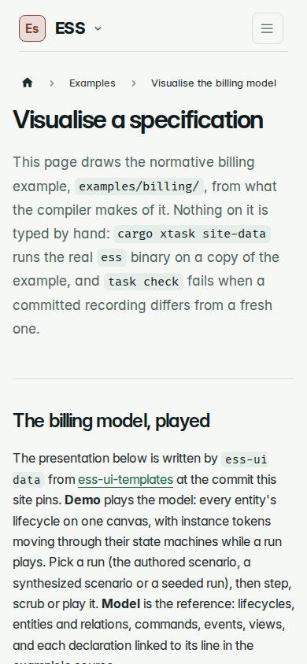
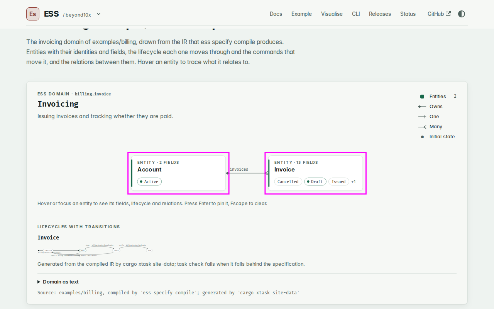
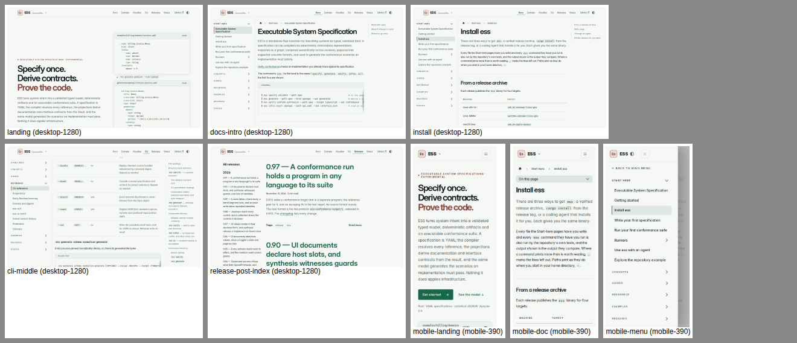
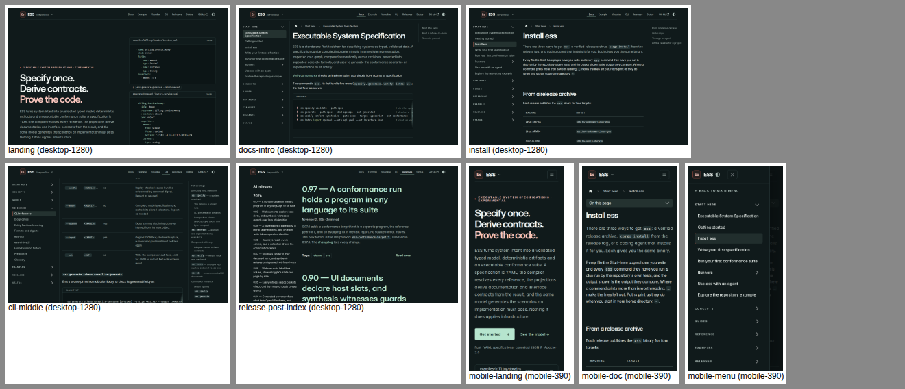

# UX round R-05: ESS documentation website

Date 2026-11-23. Engine: commit `f9c03e8394c9`, digest `8d03a2813ab593f9`. Gating viewports desktop-1280, mobile-390; measured only desktop-1440, desktop-1024, tablet-768; themes light and dark. Hermetic: every request off the local origin aborted.

Cards: anchors `first-conformance-run`, `install-linux-x86_64`; rotating `page-a-view`. No person ran them this round: the screen-only user played every task (L3), the questionnaire has no answers, and no session was recorded.

## Coverage

| what | measured of expected |
| --- | --- |
| pages (every configuration measured) | 139 of 139 |
| page configurations (page × gating viewport × theme) | 556 of 556 |
|   desktop-1280/dark | 139 of 139 |
|   desktop-1280/light | 139 of 139 |
|   mobile-390/dark | 139 of 139 |
|   mobile-390/light | 139 of 139 |
| task runs | 22 of 22 |
| measured-only configurations | 417 of 417 |

Unmeasured: none.

## Gates

| gate | result | counts |
| --- | --- | --- |
| 1 no horizontal overflow | pass | 0 of 139 measured pages; 0 with page scroll; 0 spills |
| 2 always visible | pass | 0 of 139 measured pages; none; measured only, not gated: docs sidebar: out of viewport at end ×135; blog sidebar: out of viewport at end ×136 |
| 3 unmissable completion | pass | completion_miss 0, false_complete 0 |
| 4 screen-only user | fail | 18 of 18 pointer runs completed, 5 over the card's action limit |
| 5 accessibility (axe) | fail | 27 serious/critical nodes on 2 of 139 measured pages; label-content-name-mismatch (serious) 6 nodes on 2 pages; color-contrast (serious) 18 nodes on 1 pages; nested-interactive (serious) 2 nodes on 1 pages; scrollable-region-focusable (serious) 1 nodes on 1 pages |
| 5 keyboard only | pass | 4 of 4 keyboard runs completed |
| truncation | pass | 0 texts on 0 of 139 measured pages |
| reduced motion | pass | 0 of 139 measured pages animate or scroll smoothly under reduce |
| 6 cue truth | dropped | no guidance cue on a docs site |

Task runs over their card's limit:

- first-conformance-run/mobile-390: 4 actions, limit 3
- limitations/mobile-390: 4 actions, limit 3
- page-a-view/mobile-390: 11 actions, limit 5
- theme-dark-and-back/desktop-1280: 3 actions, limit 2
- theme-dark-and-back/mobile-390: 4 actions, limit 2

## Runs

Every run of this round, with its own time against the 120 s step budget of the gate lane. A project that ran no test is not listed. "Known" failures are the regression assets of open findings, expected to fail; "new" failures are every other failed test and every open finding's asset that passed: a run exits 1 on any new failure.

| run | lane | engine | workers | wall s | status | failed: known, new | projects (tests, wall s) | pages | task runs | unmeasured |
| --- | --- | --- | --- | --- | --- | --- | --- | --- | --- | --- |
| slow-l2-1 | slow | f9c03e8394c9 8d03a2813ab593f9 | 4 | 261.3 | passed | 2, 0 | l2-1 47, 256.8 | 47 of 47 | 0 of 0 | 1 |
| slow-l2-2 | slow | f9c03e8394c9 8d03a2813ab593f9 | 4 | 182.2 | passed | 2, 0 | l2-2 47, 178.2 | 47 of 47 | 0 of 0 | 1 |
| slow-l2-3 | slow | f9c03e8394c9 8d03a2813ab593f9 | 4 | 67.6 | passed | 0, 0 | l2-3 46, 66.3 | 46 of 46 | 0 of 0 | 1 |
| slow-l2-4 | slow | f9c03e8394c9 8d03a2813ab593f9 | 4 | 94.6 | passed | 0, 0 | l2-4 46, 93.8 | 46 of 46 | 0 of 0 | 1 |
| slow-l2-5 | slow | f9c03e8394c9 8d03a2813ab593f9 | 4 | 110.2 | failed | 0, 1 | l2-5 46, 108.4 | 45 of 46 | 0 of 0 | 2 |
| slow-l2-6 | slow | f9c03e8394c9 8d03a2813ab593f9 | 4 | 102 | passed | 0, 0 | l2-6 46, 98.5 | 46 of 46 | 0 of 0 | 1 |
| slow-l3 | slow | f9c03e8394c9 8d03a2813ab593f9 | 4 | 49.9 | passed | 5, 0 | l3 22, 48 | 0 of 0 | 22 of 22 | 0 |
| slow-measured | slow | f9c03e8394c9 8d03a2813ab593f9 | 4 | 150.1 | passed | 0, 0 | measured 139, 148.4 | 0 of 0 | 0 of 0 | 0 |
| slow-nested | slow | f9c03e8394c9 8d03a2813ab593f9 | 4 | 3.7 | passed | 0, 0 | nested 4, 3 | 0 of 0 | 0 of 0 | 0 |
| slow-rerun-a | slow | f9c03e8394c9 8d03a2813ab593f9 | 4 | 28.2 | passed | 0, 0 | l2-5 1, 25.5 | 1 of 1 | 0 of 0 | 1 |
| slow-rerun-b | slow | f9c03e8394c9 8d03a2813ab593f9 | 4 | 3.7 | passed | 1, 0 | l2-1 1, 2.7; l2-3 1, 2.2; l2-5 1, 2.7 | 3 of 3 | 0 of 0 | 1 |
| gate-5 | gate | f9c03e8394c9 8d03a2813ab593f9 | 4 | 116.5 | timedout | 5, 0 | l1 22, 33.5; l2 11, 90; l3 3, 25.4 | 5 of 5 | 3 of 3 | 0 |
| gate-6 | gate | f9c03e8394c9 8d03a2813ab593f9 | 4 | 116.2 | timedout | 3, 0 | l2 8, 96; l3 3, 39.1 | 3 of 5 | 3 of 3 | 6 |
| gate-7 | gate | f9c03e8394c9 8d03a2813ab593f9 | 4 | 117.2 | timedout | 5, 0 | l1 31, 22.4; l2 11, 88.4; l3 3, 38.8 | 5 of 5 | 3 of 3 | 0 |
| gate-8 | gate | f9c03e8394c9 8d03a2813ab593f9 | 4 | 19.5 | passed | 5, 0 | l1 48, 5.6; l2 11, 13.4; l3 3, 4 | 5 of 5 | 3 of 3 | 0 |

Ten slowest tests of the measurement:

| s | status | run | test |
| --- | --- | --- | --- |
| 60 | timedOut | slow-l2-5 | L2 /ess/docs/reference/ess-ui desktop-1280 |
| 56.8 | passed | slow-l2-6 | L2 /ess/docs/reference/ess-ui mobile-390 |
| 49.6 | passed | slow-l2-1 | L2 /ess/docs/reference/predicates desktop-1280 |
| 43.4 | passed | slow-l2-2 | L2 /ess/docs/reference/predicates mobile-390 |
| 36.8 | passed | slow-l2-1 | L2 /ess/docs/concepts/component-delivery desktop-1280 |
| 36.2 | passed | slow-l2-1 | L2 /ess/docs/guides/deliver/build-and-chart desktop-1280 |
| 32.2 | passed | slow-l2-2 | L2 /ess/docs/reference/diagnostics mobile-390 |
| 31.4 | passed | slow-l2-6 | L2 /ess/docs/reference/cli mobile-390 |
| 30.4 | failed | slow-l2-1 | L2 /ess/ desktop-1280 |
| 30.2 | passed | slow-l2-1 | L2 /ess/docs/guides/generate-artifacts desktop-1280 |

Where the slowest pages spent their time (ms per step; -1: the step did not end):

- /ess/docs/reference/ess-ui at mobile-390: goto 2181, hydrate 3542, theme light 283, layout light 452, visible light 1627, axe light 16944, theme dark 11194, layout dark 470, visible dark 1103, axe dark 18789
- /ess/docs/reference/predicates at desktop-1280: goto 1250, hydrate 4182, theme light 722, layout light 427, visible light 1785, axe light 16141, theme dark 5354, layout dark 990, visible dark 1800, axe dark 16377
- /ess/docs/reference/predicates at mobile-390: goto 2751, hydrate 4206, theme light 1710, layout light 333, visible light 1755, axe light 15395, theme dark 6150, layout dark 549, visible dark 1255, axe dark 8912

## Screen-only user (L3)

| task | viewport | mode | done | actions (limit) | steers | looks | glance p95 | time to act max | reading load max | note |
| --- | --- | --- | --- | --- | --- | --- | --- | --- | --- | --- |
| diagnostic-type-009 | desktop-1280 | pointer | yes | 3 (5) | 0 | 3 | 2 | 1 | 264 |  |
| diagnostic-type-009 | mobile-390 | pointer | yes | 4 (5) | 1 | 3 | 3 | 2 | 139 |  |
| ess-31-release | desktop-1280 | pointer | yes | 3 (6) | 0 | 3 | 2 | 1 | 322 |  |
| ess-31-release | mobile-390 | pointer | yes | 5 (6) | 2 | 3 | 3 | 2 | 177 |  |
| first-conformance-run | desktop-1280 | pointer | yes | 2 (3) | 0 | 1 | 2 | 1 | 205 |  |
| first-conformance-run | desktop-1280 | keyboard | yes | 23 (–) | 0 | 2 | 3 | 1 | 205 |  |
| first-conformance-run | mobile-390 | pointer | yes | 4 (3) | 2 | 2 | 3 | 2 | 108 |  |
| first-conformance-run | mobile-390 | keyboard | yes | 131 (–) | 2 | 2 | 3 | 2 | 108 |  |
| go-runner | desktop-1280 | pointer | yes | 2 (3) | 0 | 2 | 2 | 1 | 214 |  |
| go-runner | mobile-390 | pointer | yes | 3 (3) | 1 | 2 | 3 | 2 | 142 |  |
| install-linux-x86_64 | desktop-1280 | pointer | yes | 2 (4) | 0 | 1 | 2 | 1 | 205 |  |
| install-linux-x86_64 | desktop-1280 | keyboard | yes | 21 (–) | 0 | 2 | 3 | 1 | 205 |  |
| install-linux-x86_64 | mobile-390 | pointer | yes | 4 (4) | 2 | 2 | 3 | 2 | 120 |  |
| install-linux-x86_64 | mobile-390 | keyboard | yes | 129 (–) | 2 | 2 | 3 | 2 | 120 |  |
| limitations | desktop-1280 | pointer | yes | 2 (3) | 0 | 1 | 2 | 1 | 176 |  |
| limitations | mobile-390 | pointer | yes | 4 (3) | 2 | 2 | 3 | 2 | 108 |  |
| page-a-view | desktop-1280 | pointer | yes | 4 (5) | 0 | 3 | 2 | 1 | 258 |  |
| page-a-view | mobile-390 | pointer | yes | 11 (5) | 8 | 4 | 3 | 6 | 144 |  |
| target-process | desktop-1280 | pointer | yes | 2 (4) | 0 | 1 | 2 | 1 | 240 |  |
| target-process | mobile-390 | pointer | yes | 4 (4) | 2 | 1 | 3 | 3 | 116 |  |
| theme-dark-and-back | desktop-1280 | pointer | yes | 3 (2) | 0 | 0 | 1 | 1 | 215 |  |
| theme-dark-and-back | mobile-390 | pointer | yes | 4 (2) | 1 | 2 | 3 | 2 | 194 |  |

## Metrics against the baseline and the last round

All lower is better. 556 page configurations and 22 task runs hold values; the page values are summed per viewport and theme here, every value is in round.json.

The baseline column is `baseline.json` as committed with this round, after the ratchet took the round in: UX ratchet baseline of the ESS documentation website, lower is better; written by cargo xtask ux-ratchet --update: lane full from round R-05, lane gate from round R-05; 3556 values in 578 scenario(s)

| scenario | key | this round | baseline | last round |
| --- | --- | --- | --- | --- |
| pages @desktop-1280/dark (sum) | layout.spills | 0 | 0 | 0 |
| pages @desktop-1280/dark (sum) | layout.truncated_texts | 0 | 0 | 0 |
| pages @desktop-1280/dark (sum) | always_visible.failures | 0 | 0 | 0 |
| pages @desktop-1280/dark (sum) | axe.serious_critical_rules | 1 | 1 | 2 |
| pages @desktop-1280/dark (sum) | axe.serious_critical_nodes | 1 | 1 | 2 |
| pages @desktop-1280/light (sum) | layout.spills | 0 | 0 | 0 |
| pages @desktop-1280/light (sum) | layout.truncated_texts | 0 | 0 | 0 |
| pages @desktop-1280/light (sum) | always_visible.failures | 0 | 0 | 0 |
| pages @desktop-1280/light (sum) | axe.serious_critical_rules | 4 | 4 | 5 |
| pages @desktop-1280/light (sum) | axe.serious_critical_nodes | 12 | 12 | 13 |
| pages @desktop-1280/light (sum) | layout_shift.load | 0.014 | 0.014 | 0 |
| pages @desktop-1280/light (sum) | motion.running | 0 | 0 | 0 |
| pages @mobile-390/dark (sum) | layout.spills | 0 | 0 | 0 |
| pages @mobile-390/dark (sum) | layout.truncated_texts | 0 | 0 | 3 |
| pages @mobile-390/dark (sum) | always_visible.failures | 0 | 0 | 0 |
| pages @mobile-390/dark (sum) | axe.serious_critical_rules | 1 | 1 | 2 |
| pages @mobile-390/dark (sum) | axe.serious_critical_nodes | 1 | 1 | 2 |
| pages @mobile-390/light (sum) | layout.spills | 0 | 0 | 0 |
| pages @mobile-390/light (sum) | layout.truncated_texts | 0 | 0 | 3 |
| pages @mobile-390/light (sum) | always_visible.failures | 0 | 0 | 0 |
| pages @mobile-390/light (sum) | axe.serious_critical_rules | 5 | 5 | 6 |
| pages @mobile-390/light (sum) | axe.serious_critical_nodes | 13 | 13 | 14 |
| pages @mobile-390/light (sum) | layout_shift.load | 0.028 | 0.028 | 0 |
| pages @mobile-390/light (sum) | motion.running | 0 | 0 | 0 |
| diagnostic-type-009/desktop-1280 | screen_only.actions | 3 | 3 | 3 |
| diagnostic-type-009/desktop-1280 | screen_only.looks | 3 | 3 | 3 |
| diagnostic-type-009/desktop-1280 | screen_only.steers | 0 | 0 | 0 |
| diagnostic-type-009/desktop-1280 | screen_only.time_to_act_steps.max | 1 | 1 | 1 |
| diagnostic-type-009/desktop-1280 | glance_cost.median | 2 | 2 | 2 |
| diagnostic-type-009/desktop-1280 | glance_cost.p95 | 2 | 2 | 2 |
| diagnostic-type-009/desktop-1280 | reading_load.max | 264 | 256 | 265 |
| diagnostic-type-009/desktop-1280 | reading_load.median | 217 | 217 | 201 |
| diagnostic-type-009/desktop-1280 | completion_miss | 0 | 0 | 0 |
| diagnostic-type-009/desktop-1280 | false_complete | 0 | 0 | 0 |
| diagnostic-type-009/mobile-390 | screen_only.actions | 4 | 4 | 4 |
| diagnostic-type-009/mobile-390 | screen_only.looks | 3 | 3 | 3 |
| diagnostic-type-009/mobile-390 | screen_only.steers | 1 | 1 | 1 |
| diagnostic-type-009/mobile-390 | screen_only.time_to_act_steps.max | 2 | 2 | 2 |
| diagnostic-type-009/mobile-390 | glance_cost.median | 2 | 2 | 2 |
| diagnostic-type-009/mobile-390 | glance_cost.p95 | 3 | 3 | 3 |
| diagnostic-type-009/mobile-390 | reading_load.max | 139 | 139 | 165 |
| diagnostic-type-009/mobile-390 | reading_load.median | 123 | 123 | 137 |
| diagnostic-type-009/mobile-390 | completion_miss | 0 | 0 | 0 |
| diagnostic-type-009/mobile-390 | false_complete | 0 | 0 | 0 |
| ess-31-release/desktop-1280 | screen_only.actions | 3 | 3 | 3 |
| ess-31-release/desktop-1280 | screen_only.looks | 3 | 3 | 3 |
| ess-31-release/desktop-1280 | screen_only.steers | 0 | 0 | 0 |
| ess-31-release/desktop-1280 | screen_only.time_to_act_steps.max | 1 | 1 | 1 |
| ess-31-release/desktop-1280 | glance_cost.median | 2 | 2 | 2 |
| ess-31-release/desktop-1280 | glance_cost.p95 | 2 | 2 | 2 |
| ess-31-release/desktop-1280 | reading_load.max | 322 | 322 | 358 |
| ess-31-release/desktop-1280 | reading_load.median | 217 | 217 | 201 |
| ess-31-release/desktop-1280 | completion_miss | 0 | 0 | 0 |
| ess-31-release/desktop-1280 | false_complete | 0 | 0 | 0 |
| ess-31-release/mobile-390 | screen_only.actions | 5 | 5 | 5 |
| ess-31-release/mobile-390 | screen_only.looks | 3 | 3 | 3 |
| ess-31-release/mobile-390 | screen_only.steers | 2 | 2 | 2 |
| ess-31-release/mobile-390 | screen_only.time_to_act_steps.max | 2 | 2 | 2 |
| ess-31-release/mobile-390 | glance_cost.median | 3 | 3 | 3 |
| ess-31-release/mobile-390 | glance_cost.p95 | 3 | 3 | 3 |
| ess-31-release/mobile-390 | reading_load.max | 177 | 177 | 164 |
| ess-31-release/mobile-390 | reading_load.median | 139 | 137 | 137 |
| ess-31-release/mobile-390 | completion_miss | 0 | 0 | 0 |
| ess-31-release/mobile-390 | false_complete | 0 | 0 | 0 |
| first-conformance-run/desktop-1280 | screen_only.actions | 2 | 2 | 2 |
| first-conformance-run/desktop-1280 | screen_only.looks | 1 | 1 | 1 |
| first-conformance-run/desktop-1280 | screen_only.steers | 0 | 0 | 0 |
| first-conformance-run/desktop-1280 | screen_only.time_to_act_steps.max | 1 | 1 | 1 |
| first-conformance-run/desktop-1280 | glance_cost.median | 1 | 1 | 1 |
| first-conformance-run/desktop-1280 | glance_cost.p95 | 2 | 2 | 2 |
| first-conformance-run/desktop-1280 | reading_load.max | 205 | 205 | 189 |
| first-conformance-run/desktop-1280 | reading_load.median | 189 | 189 | 189 |
| first-conformance-run/desktop-1280 | completion_miss | 0 | 0 | 0 |
| first-conformance-run/desktop-1280 | false_complete | 0 | 0 | 0 |
| first-conformance-run/desktop-1280/keyboard | screen_only.actions | 23 | 23 | 23 |
| first-conformance-run/desktop-1280/keyboard | screen_only.looks | 2 | 2 | 2 |
| first-conformance-run/desktop-1280/keyboard | screen_only.steers | 0 | 0 | 0 |
| first-conformance-run/desktop-1280/keyboard | screen_only.time_to_act_steps.max | 1 | 1 | 1 |
| first-conformance-run/desktop-1280/keyboard | glance_cost.median | 3 | 3 | 3 |
| first-conformance-run/desktop-1280/keyboard | glance_cost.p95 | 3 | 3 | 3 |
| first-conformance-run/desktop-1280/keyboard | reading_load.max | 205 | 205 | 189 |
| first-conformance-run/desktop-1280/keyboard | reading_load.median | 189 | 189 | 189 |
| first-conformance-run/desktop-1280/keyboard | completion_miss | 0 | 0 | 0 |
| first-conformance-run/desktop-1280/keyboard | false_complete | 0 | 0 | 0 |
| first-conformance-run/mobile-390 | screen_only.actions | 4 | 4 | 4 |
| first-conformance-run/mobile-390 | screen_only.looks | 2 | 2 | 2 |
| first-conformance-run/mobile-390 | screen_only.steers | 2 | 2 | 2 |
| first-conformance-run/mobile-390 | screen_only.time_to_act_steps.max | 2 | 2 | 2 |
| first-conformance-run/mobile-390 | glance_cost.median | 3 | 3 | 3 |
| first-conformance-run/mobile-390 | glance_cost.p95 | 3 | 3 | 3 |
| first-conformance-run/mobile-390 | reading_load.max | 108 | 108 | 108 |
| first-conformance-run/mobile-390 | reading_load.median | 96 | 94 | 94 |
| first-conformance-run/mobile-390 | completion_miss | 0 | 0 | 0 |
| first-conformance-run/mobile-390 | false_complete | 0 | 0 | 0 |
| first-conformance-run/mobile-390/keyboard | screen_only.actions | 131 | 131 | 131 |
| first-conformance-run/mobile-390/keyboard | screen_only.looks | 2 | 2 | 2 |
| first-conformance-run/mobile-390/keyboard | screen_only.steers | 2 | 2 | 2 |
| first-conformance-run/mobile-390/keyboard | screen_only.time_to_act_steps.max | 2 | 2 | 2 |
| first-conformance-run/mobile-390/keyboard | glance_cost.median | 3 | 3 | 3 |
| first-conformance-run/mobile-390/keyboard | glance_cost.p95 | 3 | 3 | 3 |
| first-conformance-run/mobile-390/keyboard | reading_load.max | 108 | 108 | 108 |
| first-conformance-run/mobile-390/keyboard | reading_load.median | 96 | 94 | 94 |
| first-conformance-run/mobile-390/keyboard | completion_miss | 0 | 0 | 0 |
| first-conformance-run/mobile-390/keyboard | false_complete | 0 | 0 | 0 |
| go-runner/desktop-1280 | screen_only.actions | 2 | 2 | 2 |
| go-runner/desktop-1280 | screen_only.looks | 2 | 2 | 2 |
| go-runner/desktop-1280 | screen_only.steers | 0 | 0 | 0 |
| go-runner/desktop-1280 | screen_only.time_to_act_steps.max | 1 | 1 | 1 |
| go-runner/desktop-1280 | glance_cost.median | 2 | 2 | 2 |
| go-runner/desktop-1280 | glance_cost.p95 | 2 | 2 | 2 |
| go-runner/desktop-1280 | reading_load.max | 214 | 214 | 198 |
| go-runner/desktop-1280 | reading_load.median | 205 | 205 | 189 |
| go-runner/desktop-1280 | completion_miss | 0 | 0 | 0 |
| go-runner/desktop-1280 | false_complete | 0 | 0 | 0 |
| go-runner/mobile-390 | screen_only.actions | 3 | 3 | 3 |
| go-runner/mobile-390 | screen_only.looks | 2 | 2 | 2 |
| go-runner/mobile-390 | screen_only.steers | 1 | 1 | 1 |
| go-runner/mobile-390 | screen_only.time_to_act_steps.max | 2 | 2 | 2 |
| go-runner/mobile-390 | glance_cost.median | 2 | 2 | 2 |
| go-runner/mobile-390 | glance_cost.p95 | 3 | 3 | 3 |
| go-runner/mobile-390 | reading_load.max | 142 | 140 | 140 |
| go-runner/mobile-390 | reading_load.median | 96 | 94 | 94 |
| go-runner/mobile-390 | completion_miss | 0 | 0 | 0 |
| go-runner/mobile-390 | false_complete | 0 | 0 | 0 |
| install-linux-x86_64/desktop-1280 | screen_only.actions | 2 | 2 | 2 |
| install-linux-x86_64/desktop-1280 | screen_only.looks | 1 | 1 | 1 |
| install-linux-x86_64/desktop-1280 | screen_only.steers | 0 | 0 | 0 |
| install-linux-x86_64/desktop-1280 | screen_only.time_to_act_steps.max | 1 | 1 | 1 |
| install-linux-x86_64/desktop-1280 | glance_cost.median | 1 | 1 | 1 |
| install-linux-x86_64/desktop-1280 | glance_cost.p95 | 2 | 2 | 2 |
| install-linux-x86_64/desktop-1280 | reading_load.max | 205 | 205 | 189 |
| install-linux-x86_64/desktop-1280 | reading_load.median | 182 | 182 | 182 |
| install-linux-x86_64/desktop-1280 | completion_miss | 0 | 0 | 0 |
| install-linux-x86_64/desktop-1280 | false_complete | 0 | 0 | 0 |
| install-linux-x86_64/desktop-1280/keyboard | screen_only.actions | 21 | 21 | 21 |
| install-linux-x86_64/desktop-1280/keyboard | screen_only.looks | 2 | 2 | 2 |
| install-linux-x86_64/desktop-1280/keyboard | screen_only.steers | 0 | 0 | 0 |
| install-linux-x86_64/desktop-1280/keyboard | screen_only.time_to_act_steps.max | 1 | 1 | 1 |
| install-linux-x86_64/desktop-1280/keyboard | glance_cost.median | 3 | 3 | 3 |
| install-linux-x86_64/desktop-1280/keyboard | glance_cost.p95 | 3 | 3 | 3 |
| install-linux-x86_64/desktop-1280/keyboard | reading_load.max | 205 | 205 | 189 |
| install-linux-x86_64/desktop-1280/keyboard | reading_load.median | 182 | 182 | 182 |
| install-linux-x86_64/desktop-1280/keyboard | completion_miss | 0 | 0 | 0 |
| install-linux-x86_64/desktop-1280/keyboard | false_complete | 0 | 0 | 0 |
| install-linux-x86_64/mobile-390 | screen_only.actions | 4 | 4 | 4 |
| install-linux-x86_64/mobile-390 | screen_only.looks | 2 | 2 | 2 |
| install-linux-x86_64/mobile-390 | screen_only.steers | 2 | 2 | 2 |
| install-linux-x86_64/mobile-390 | screen_only.time_to_act_steps.max | 2 | 2 | 2 |
| install-linux-x86_64/mobile-390 | glance_cost.median | 3 | 3 | 3 |
| install-linux-x86_64/mobile-390 | glance_cost.p95 | 3 | 3 | 3 |
| install-linux-x86_64/mobile-390 | reading_load.max | 120 | 120 | 120 |
| install-linux-x86_64/mobile-390 | reading_load.median | 96 | 94 | 94 |
| install-linux-x86_64/mobile-390 | completion_miss | 0 | 0 | 0 |
| install-linux-x86_64/mobile-390 | false_complete | 0 | 0 | 0 |
| install-linux-x86_64/mobile-390/keyboard | screen_only.actions | 129 | 129 | 129 |
| install-linux-x86_64/mobile-390/keyboard | screen_only.looks | 2 | 2 | 2 |
| install-linux-x86_64/mobile-390/keyboard | screen_only.steers | 2 | 2 | 2 |
| install-linux-x86_64/mobile-390/keyboard | screen_only.time_to_act_steps.max | 2 | 2 | 2 |
| install-linux-x86_64/mobile-390/keyboard | glance_cost.median | 3 | 3 | 3 |
| install-linux-x86_64/mobile-390/keyboard | glance_cost.p95 | 3 | 3 | 3 |
| install-linux-x86_64/mobile-390/keyboard | reading_load.max | 120 | 120 | 120 |
| install-linux-x86_64/mobile-390/keyboard | reading_load.median | 96 | 94 | 94 |
| install-linux-x86_64/mobile-390/keyboard | completion_miss | 0 | 0 | 0 |
| install-linux-x86_64/mobile-390/keyboard | false_complete | 0 | 0 | 0 |
| limitations/desktop-1280 | screen_only.actions | 2 | 2 | 2 |
| limitations/desktop-1280 | screen_only.looks | 1 | 1 | 1 |
| limitations/desktop-1280 | screen_only.steers | 0 | 0 | 0 |
| limitations/desktop-1280 | screen_only.time_to_act_steps.max | 1 | 1 | 1 |
| limitations/desktop-1280 | glance_cost.median | 1 | 1 | 1 |
| limitations/desktop-1280 | glance_cost.p95 | 2 | 2 | 2 |
| limitations/desktop-1280 | reading_load.max | 176 | 176 | 165 |
| limitations/desktop-1280 | reading_load.median | 165 | 164 | 164 |
| limitations/desktop-1280 | completion_miss | 0 | 0 | 0 |
| limitations/desktop-1280 | false_complete | 0 | 0 | 0 |
| limitations/mobile-390 | screen_only.actions | 4 | 4 | 4 |
| limitations/mobile-390 | screen_only.looks | 2 | 2 | 2 |
| limitations/mobile-390 | screen_only.steers | 2 | 2 | 2 |
| limitations/mobile-390 | screen_only.time_to_act_steps.max | 2 | 2 | 2 |
| limitations/mobile-390 | glance_cost.median | 3 | 3 | 3 |
| limitations/mobile-390 | glance_cost.p95 | 3 | 3 | 3 |
| limitations/mobile-390 | reading_load.max | 108 | 106 | 106 |
| limitations/mobile-390 | reading_load.median | 87 | 86 | 86 |
| limitations/mobile-390 | completion_miss | 0 | 0 | 0 |
| limitations/mobile-390 | false_complete | 0 | 0 | 0 |
| page-a-view/desktop-1280 | screen_only.actions | 4 | 4 | 4 |
| page-a-view/desktop-1280 | screen_only.looks | 3 | 3 | 3 |
| page-a-view/desktop-1280 | screen_only.steers | 0 | 0 | 0 |
| page-a-view/desktop-1280 | screen_only.time_to_act_steps.max | 1 | 1 | 1 |
| page-a-view/desktop-1280 | glance_cost.median | 2 | 2 | 2 |
| page-a-view/desktop-1280 | glance_cost.p95 | 2 | 2 | 2 |
| page-a-view/desktop-1280 | reading_load.max | 258 | 258 | 230 |
| page-a-view/desktop-1280 | reading_load.median | 220 | 214 | 214 |
| page-a-view/desktop-1280 | completion_miss | 0 | 0 | 0 |
| page-a-view/desktop-1280 | false_complete | 0 | 0 | 0 |
| page-a-view/mobile-390 | screen_only.actions | 11 | 11 | 11 |
| page-a-view/mobile-390 | screen_only.looks | 4 | 4 | 4 |
| page-a-view/mobile-390 | screen_only.steers | 8 | 8 | 8 |
| page-a-view/mobile-390 | screen_only.time_to_act_steps.max | 6 | 6 | 6 |
| page-a-view/mobile-390 | glance_cost.median | 3 | 3 | 3 |
| page-a-view/mobile-390 | glance_cost.p95 | 3 | 3 | 3 |
| page-a-view/mobile-390 | reading_load.max | 144 | 142 | 142 |
| page-a-view/mobile-390 | reading_load.median | 99 | 99 | 102 |
| page-a-view/mobile-390 | completion_miss | 0 | 0 | 0 |
| page-a-view/mobile-390 | false_complete | 0 | 0 | 0 |
| target-process/desktop-1280 | screen_only.actions | 2 | 2 | 2 |
| target-process/desktop-1280 | screen_only.looks | 1 | 1 | 1 |
| target-process/desktop-1280 | screen_only.steers | 0 | 0 | 0 |
| target-process/desktop-1280 | screen_only.time_to_act_steps.max | 1 | 1 | 1 |
| target-process/desktop-1280 | glance_cost.median | 1 | 1 | 1 |
| target-process/desktop-1280 | glance_cost.p95 | 2 | 2 | 2 |
| target-process/desktop-1280 | reading_load.max | 240 | 240 | 252 |
| target-process/desktop-1280 | reading_load.median | 214 | 213 | 213 |
| target-process/desktop-1280 | completion_miss | 0 | 0 | 0 |
| target-process/desktop-1280 | false_complete | 0 | 0 | 0 |
| target-process/mobile-390 | screen_only.actions | 4 | 4 | 4 |
| target-process/mobile-390 | screen_only.looks | 1 | 1 | 1 |
| target-process/mobile-390 | screen_only.steers | 2 | 2 | 2 |
| target-process/mobile-390 | screen_only.time_to_act_steps.max | 3 | 3 | 3 |
| target-process/mobile-390 | glance_cost.median | 1 | 1 | 1 |
| target-process/mobile-390 | glance_cost.p95 | 3 | 3 | 3 |
| target-process/mobile-390 | reading_load.max | 116 | 116 | 122 |
| target-process/mobile-390 | reading_load.median | 114 | 113 | 113 |
| target-process/mobile-390 | completion_miss | 0 | 0 | 0 |
| target-process/mobile-390 | false_complete | 0 | 0 | 0 |
| theme-dark-and-back/desktop-1280 | screen_only.actions | 3 | 3 | 3 |
| theme-dark-and-back/desktop-1280 | screen_only.looks | 0 | 0 | 0 |
| theme-dark-and-back/desktop-1280 | screen_only.steers | 0 | 0 | 0 |
| theme-dark-and-back/desktop-1280 | screen_only.time_to_act_steps.max | 1 | 1 | 1 |
| theme-dark-and-back/desktop-1280 | glance_cost.median | 1 | 1 | 1 |
| theme-dark-and-back/desktop-1280 | glance_cost.p95 | 1 | 1 | 1 |
| theme-dark-and-back/desktop-1280 | reading_load.max | 215 | 215 | 215 |
| theme-dark-and-back/desktop-1280 | reading_load.median | 215 | 215 | 215 |
| theme-dark-and-back/desktop-1280 | completion_miss | 0 | 0 | 0 |
| theme-dark-and-back/desktop-1280 | false_complete | 0 | 0 | 0 |
| theme-dark-and-back/mobile-390 | screen_only.actions | 4 | 4 | 4 |
| theme-dark-and-back/mobile-390 | screen_only.looks | 2 | 2 | 2 |
| theme-dark-and-back/mobile-390 | screen_only.steers | 1 | 1 | 1 |
| theme-dark-and-back/mobile-390 | screen_only.time_to_act_steps.max | 2 | 2 | 2 |
| theme-dark-and-back/mobile-390 | glance_cost.median | 2.5 | 2.5 | 2.5 |
| theme-dark-and-back/mobile-390 | glance_cost.p95 | 3 | 3 | 3 |
| theme-dark-and-back/mobile-390 | reading_load.max | 194 | 194 | 194 |
| theme-dark-and-back/mobile-390 | reading_load.median | 174.5 | 174.5 | 174.5 |
| theme-dark-and-back/mobile-390 | completion_miss | 0 | 0 | 0 |
| theme-dark-and-back/mobile-390 | false_complete | 0 | 0 | 0 |

## Values a rerun replaced

A scenario more than one run measured, with every run's value. "This round" above is the last run's; the ratchet holds the worst of them unless a decision names the key.

| scenario | key | values by run | held by the ratchet |
| --- | --- | --- | --- |
| /ess/@desktop-1280/light | layout_shift.load | slow-l2-1 0.095; slow-rerun-b 0 | 0.095 |

## Measured-only viewports

| viewport | pages measured | with page scroll | with a spill | with an always-visible element out of view, covered or missing (in the states gate 2 gates) | truncated texts |
| --- | --- | --- | --- | --- | --- |
| desktop-1440 | 139 of 139 | 0 | 0 | 1 | 0 |
| desktop-1024 | 139 of 139 | 0 | 0 | 0 | 0 |
| tablet-768 | 139 of 139 | 0 | 0 | 0 | 0 |

## Worst moments

- /ess/docs/visualise at mobile-390, light: axe color-contrast×8, label-content-name-mismatch×1, nested-interactive×1, scrollable-region-focusable×1 (magenta outline: the first axe nodes)
  
- /ess/ at desktop-1280, light: axe label-content-name-mismatch×2 (magenta outline: the first axe nodes)
  

## Contact sheets

## Missing inputs

- L6 recorded live rounds and the questionnaire: no person took part in this round.
- Recordings (rrweb): none; the screen-only user's states are in the runs' raw.json.
- L4 keyed replay, L5 discoverability probe, L7 review agents: run by the coordinator after this report.

## Notes of the round (written by hand in notes.md; every number is one of round.json)

- The gate lane runs 13 browser tests (change 1, UXF-025), about half of R-04's. It still does not
  hold its 120 s on a loaded host: `gate-5`, `gate-6` and `gate-7` started at a 1-minute load of
  133.47 to 169.55 and were cut at 116.2 to 117.2 s of wall time (status `timedout`, no new
  failure); `gate-8` started at 60.06 and passed in 19.5 s. UXF-025 records three earlier runs on
  the engine of change 1, which this `round.json` does not hold. UXF-025 stays open.
- The slow lane's nine jobs ran at 55.92 to 131.15. One test timed out, `L2
  /ess/docs/reference/ess-ui desktop-1280` in `slow-l2-5` (load 78.21), and passed in
  `slow-rerun-a`; the ratchet takes `slow-l2-5` because a later run of the round passed the test
  it failed (T41).
- Truncated texts went from 6 to 0 and the release archive's contrast nodes from 4 to 0 (change 4,
  UXF-009 closed, UXF-006's archive part); gate 5 still fails on the visualise page's frame and the
  landing page's graph (UXF-005 to UXF-008), owned by the templates package and the shared docs
  theme.
- The index lists are named navigations (change 5, UXF-027). `glance_cost.p95` of
  `ess-31-release/mobile-390` and `diagnostic-type-009/mobile-390` stays 3: on a phone the first
  step opens the menu, and that step is already outside the primary region. UXF-027 stays open on
  its metric.
- Eleven reading-load values are worse than the baseline beyond their tolerance and carry
  `R-05-worse` (`decision.md`); nine of them come from `main`'s text on the docs introduction.
  Fourteen more are worse inside their tolerance; the ratchet names each in a note (T36).
- `layout_shift.load` and `motion.running` are filed under the light configuration (T34): 556 dark
  values dropped and 556 light values new under `R-05-worse`. The two R-04 shifts taken under load
  (`../R-04/decision.md`) measure 0 under light, and in `slow-rerun-b` at load 55.92. The landing page's
  one shift of 0.0948 in `slow-l2-1` at load 131.15 measured 0 in `slow-rerun-b`, and `R-05-worse`
  takes that 0 by name.
