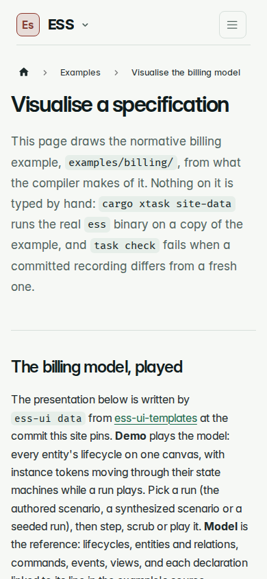
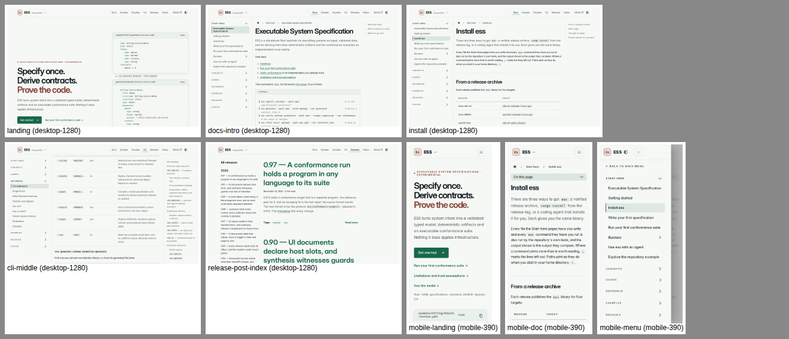
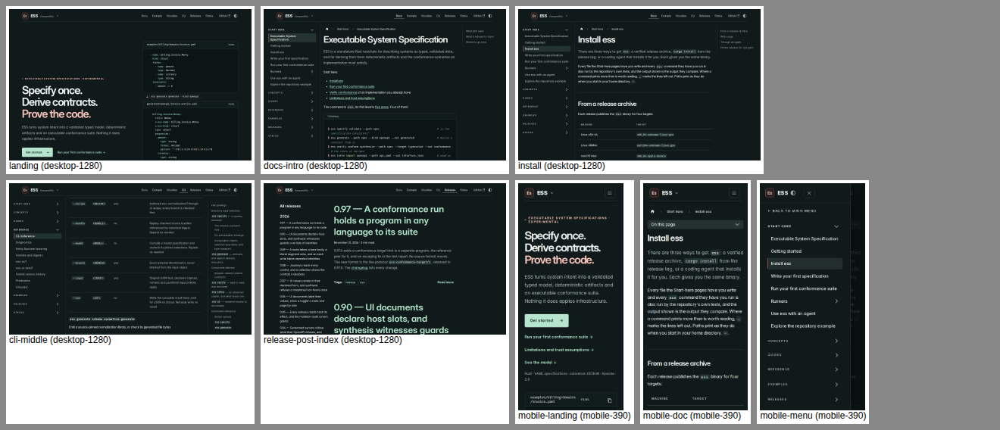

# UX round R-06: ESS documentation website

Date 2026-11-23. Engine: commit `e9479fac0601`, digest `de0896f8b2333139`. Gating viewports desktop-1280, mobile-390; measured only desktop-1440, desktop-1024, tablet-768; themes light and dark. Hermetic: every request off the local origin aborted.

Cards: anchors `first-conformance-run`, `install-linux-x86_64`; rotating `target-process`. No person ran them this round: the screen-only user played every task (L3), the questionnaire has no answers, and no session was recorded.

## Coverage

| what | measured of expected |
| --- | --- |
| pages (every configuration measured) | 139 of 139 |
| page configurations (page × gating viewport × theme) | 556 of 556 |
|   desktop-1280/dark | 139 of 139 |
|   desktop-1280/light | 139 of 139 |
|   mobile-390/dark | 139 of 139 |
|   mobile-390/light | 139 of 139 |
| task runs | 22 of 22 |
| measured-only configurations | 417 of 417 |

Unmeasured: none.

## Gates

| gate | result | counts |
| --- | --- | --- |
| 1 no horizontal overflow | pass | 0 of 139 measured pages; 0 with page scroll; 0 spills |
| 2 always visible | pass | 0 of 139 measured pages; none; measured only, not gated: docs sidebar: out of viewport at end ×136; blog sidebar: out of viewport at end ×136 |
| 3 unmissable completion | pass | completion_miss 0, false_complete 0 |
| 4 screen-only user | fail | 18 of 18 pointer runs completed, 3 over the card's action limit |
| 5 accessibility (axe) | fail | 23 serious/critical nodes on 1 of 139 measured pages; color-contrast (serious) 18 nodes on 1 pages; label-content-name-mismatch (serious) 2 nodes on 1 pages; nested-interactive (serious) 2 nodes on 1 pages; scrollable-region-focusable (serious) 1 nodes on 1 pages |
| 5 keyboard only | pass | 4 of 4 keyboard runs completed |
| truncation | pass | 0 texts on 0 of 139 measured pages |
| reduced motion | pass | 0 of 139 measured pages animate or scroll smoothly under reduce |
| 6 cue truth | dropped | no guidance cue on a docs site |

Task runs over their card's limit:

- page-a-view/mobile-390: 11 actions, limit 5
- theme-dark-and-back/desktop-1280: 3 actions, limit 2
- theme-dark-and-back/mobile-390: 4 actions, limit 2

## Runs

Every run of this round, with its own time against the 120 s step budget of the gate lane. A project that ran no test is not listed. "Known" failures are the regression assets of open findings, expected to fail; "new" failures are every other failed test and every open finding's asset that passed: a run exits 1 on any new failure.

| run | lane | engine | workers | wall s | status | failed: known, new | projects (tests, wall s) | pages | task runs | unmeasured |
| --- | --- | --- | --- | --- | --- | --- | --- | --- | --- | --- |
| slow-l2-1 | slow | e9479fac0601 de0896f8b2333139 | 4 | 138.1 | failed | 1, 1 | l2-1 47, 135 | 47 of 47 | 0 of 0 | 1 |
| slow-l2-2 | slow | e9479fac0601 de0896f8b2333139 | 4 | 63.2 | failed | 1, 1 | l2-2 47, 61.6 | 47 of 47 | 0 of 0 | 1 |
| slow-l2-3 | slow | e9479fac0601 de0896f8b2333139 | 4 | 113.8 | passed | 0, 0 | l2-3 46, 111.4 | 46 of 46 | 0 of 0 | 1 |
| slow-l2-4 | slow | e9479fac0601 de0896f8b2333139 | 4 | 100.6 | passed | 0, 0 | l2-4 46, 98.8 | 46 of 46 | 0 of 0 | 1 |
| slow-l2-5 | slow | e9479fac0601 de0896f8b2333139 | 4 | 66.5 | passed | 0, 0 | l2-5 46, 62.3 | 46 of 46 | 0 of 0 | 1 |
| slow-l2-6 | slow | e9479fac0601 de0896f8b2333139 | 4 | 99.6 | failed | 0, 1 | l2-6 46, 98 | 45 of 46 | 0 of 0 | 2 |
| slow-l3 | slow | e9479fac0601 de0896f8b2333139 | 4 | 23 | passed | 3, 0 | l3 22, 21.2 | 0 of 0 | 22 of 22 | 0 |
| slow-measured | slow | e9479fac0601 de0896f8b2333139 | 4 | 160.1 | passed | 0, 0 | measured 139, 158.2 | 0 of 0 | 0 of 0 | 0 |
| slow-nested | slow | e9479fac0601 de0896f8b2333139 | 4 | 3.3 | passed | 0, 0 | nested 4, 2.7 | 0 of 0 | 0 of 0 | 0 |
| slow-rerun-a | slow | e9479fac0601 de0896f8b2333139 | 4 | 16.1 | failed | 0, 1 | l2-1 1, 2.3; l2-2 1, 2.5; l2-6 1, 14.4 | 2 of 2 | 0 of 0 | 1 |
| slow-rerun-b | slow | e9479fac0601 de0896f8b2333139 | 4 | 12.5 | passed | 0, 0 | l2-1 1, 7.5 | 1 of 1 | 0 of 0 | 1 |
| gate-1 | gate | e9479fac0601 de0896f8b2333139 | 4 | 21.2 | passed | 1, 0 | l1 56, 9.5; l2 7, 13.4; l3 3, 4.9 | 3 of 3 | 3 of 3 | 0 |
| gate-2 | gate | e9479fac0601 de0896f8b2333139 | 4 | 18.9 | passed | 1, 0 | l1 56, 8.9; l2 7, 10.3; l3 3, 3 | 3 of 3 | 3 of 3 | 0 |
| gate-3 | gate | e9479fac0601 de0896f8b2333139 | 4 | 13 | passed | 1, 0 | l1 56, 4.7; l2 7, 9; l3 3, 3.7 | 3 of 3 | 3 of 3 | 0 |

Ten slowest tests of the measurement:

| s | status | run | test |
| --- | --- | --- | --- |
| 60 | timedOut | slow-l2-6 | L2 /ess/docs/reference/ess-ui mobile-390 |
| 32.4 | passed | slow-l2-1 | L2 /ess/docs/reference/predicates desktop-1280 |
| 30.1 | passed | slow-l2-6 | L2 /ess/docs/reference/cli mobile-390 |
| 25.2 | passed | slow-l2-4 | L2 /ess/docs/reference/formats mobile-390 |
| 24.3 | passed | slow-l2-5 | L2 /ess/docs/reference/ess-ui desktop-1280 |
| 23.2 | passed | slow-l2-4 | L2 /ess/docs/reference/spec-versions mobile-390 |
| 22.3 | passed | slow-l2-3 | L2 /ess/docs/reference/formats desktop-1280 |
| 19.5 | passed | slow-l2-1 | L2 /ess/docs/reference/diagnostics desktop-1280 |
| 19 | passed | slow-l2-3 | L2 /ess/docs/reference/spec-versions desktop-1280 |
| 18.8 | passed | slow-l2-4 | L2 /ess/docs/reference/entity-runtime-lowering mobile-390 |

Where the slowest pages spent their time (ms per step; -1: the step did not end):

- /ess/docs/reference/predicates at desktop-1280: goto 1808, hydrate 1663, theme light 350, layout light 230, visible light 1371, axe light 12207, theme dark 3486, layout dark 458, visible dark 1468, axe dark 9120
- /ess/docs/reference/cli at mobile-390: goto 780, hydrate 734, theme light 483, layout light 235, visible light 742, axe light 10653, theme dark 3687, layout dark 846, visible dark 1725, axe dark 9977
- /ess/docs/reference/formats at mobile-390: goto 3401, hydrate 2534, theme light 542, layout light 324, visible light 1443, axe light 11636, theme dark 871, layout dark 57, visible dark 230, axe dark 3961

## Screen-only user (L3)

| task | viewport | mode | done | actions (limit) | steers | looks | glance p95 | time to act max | reading load max | note |
| --- | --- | --- | --- | --- | --- | --- | --- | --- | --- | --- |
| diagnostic-type-009 | desktop-1280 | pointer | yes | 3 (5) | 0 | 3 | 2 | 1 | 264 |  |
| diagnostic-type-009 | mobile-390 | pointer | yes | 4 (5) | 1 | 3 | 3 | 2 | 123 |  |
| ess-31-release | desktop-1280 | pointer | yes | 3 (6) | 0 | 3 | 2 | 1 | 322 |  |
| ess-31-release | mobile-390 | pointer | yes | 5 (6) | 2 | 3 | 3 | 2 | 177 |  |
| first-conformance-run | desktop-1280 | pointer | yes | 2 (3) | 0 | 1 | 2 | 1 | 189 |  |
| first-conformance-run | desktop-1280 | keyboard | yes | 23 (–) | 0 | 2 | 3 | 1 | 189 |  |
| first-conformance-run | mobile-390 | pointer | yes | 3 (3) | 1 | 1 | 3 | 2 | 92 |  |
| first-conformance-run | mobile-390 | keyboard | yes | 81 (–) | 1 | 2 | 3 | 2 | 92 |  |
| go-runner | desktop-1280 | pointer | yes | 2 (3) | 0 | 2 | 2 | 1 | 191 |  |
| go-runner | mobile-390 | pointer | yes | 3 (3) | 1 | 2 | 3 | 2 | 122 |  |
| install-linux-x86_64 | desktop-1280 | pointer | yes | 2 (4) | 0 | 1 | 2 | 1 | 182 |  |
| install-linux-x86_64 | desktop-1280 | keyboard | yes | 21 (–) | 0 | 2 | 3 | 1 | 182 |  |
| install-linux-x86_64 | mobile-390 | pointer | yes | 3 (4) | 1 | 1 | 3 | 2 | 120 |  |
| install-linux-x86_64 | mobile-390 | keyboard | yes | 80 (–) | 1 | 2 | 3 | 2 | 120 |  |
| limitations | desktop-1280 | pointer | yes | 2 (3) | 0 | 1 | 2 | 1 | 168 |  |
| limitations | mobile-390 | pointer | yes | 3 (3) | 1 | 1 | 3 | 2 | 87 |  |
| page-a-view | desktop-1280 | pointer | yes | 4 (5) | 0 | 3 | 2 | 1 | 258 |  |
| page-a-view | mobile-390 | pointer | yes | 11 (5) | 8 | 4 | 3 | 6 | 124 |  |
| target-process | desktop-1280 | pointer | yes | 2 (4) | 0 | 1 | 2 | 1 | 240 |  |
| target-process | mobile-390 | pointer | yes | 4 (4) | 2 | 1 | 3 | 3 | 116 |  |
| theme-dark-and-back | desktop-1280 | pointer | yes | 3 (2) | 0 | 0 | 1 | 1 | 215 |  |
| theme-dark-and-back | mobile-390 | pointer | yes | 4 (2) | 1 | 2 | 3 | 2 | 194 |  |

## Metrics against the baseline and the last round

All lower is better. 556 page configurations and 22 task runs hold values; the page values are summed per viewport and theme here, every value is in round.json.

The baseline column is `baseline.json` as committed with this round, after the ratchet took the round in: UX ratchet baseline of the ESS documentation website, lower is better; written by cargo xtask ux-ratchet --update: lane full from round R-06, lane gate from round R-05; 3556 values in 578 scenario(s)

| scenario | key | this round | baseline | last round |
| --- | --- | --- | --- | --- |
| pages @desktop-1280/dark (sum) | layout.spills | 0 | 0 | 0 |
| pages @desktop-1280/dark (sum) | layout.truncated_texts | 0 | 0 | 0 |
| pages @desktop-1280/dark (sum) | always_visible.failures | 0 | 0 | 0 |
| pages @desktop-1280/dark (sum) | axe.serious_critical_rules | 1 | 1 | 1 |
| pages @desktop-1280/dark (sum) | axe.serious_critical_nodes | 1 | 1 | 1 |
| pages @desktop-1280/light (sum) | layout.spills | 0 | 0 | 0 |
| pages @desktop-1280/light (sum) | layout.truncated_texts | 0 | 0 | 0 |
| pages @desktop-1280/light (sum) | always_visible.failures | 0 | 0 | 0 |
| pages @desktop-1280/light (sum) | axe.serious_critical_rules | 3 | 3 | 4 |
| pages @desktop-1280/light (sum) | axe.serious_critical_nodes | 10 | 10 | 12 |
| pages @desktop-1280/light (sum) | layout_shift.load | 0.013 | 0.013 | 0.014 |
| pages @desktop-1280/light (sum) | motion.running | 0 | 0 | 0 |
| pages @mobile-390/dark (sum) | layout.spills | 0 | 0 | 0 |
| pages @mobile-390/dark (sum) | layout.truncated_texts | 0 | 0 | 0 |
| pages @mobile-390/dark (sum) | always_visible.failures | 0 | 0 | 0 |
| pages @mobile-390/dark (sum) | axe.serious_critical_rules | 1 | 1 | 1 |
| pages @mobile-390/dark (sum) | axe.serious_critical_nodes | 1 | 1 | 1 |
| pages @mobile-390/light (sum) | layout.spills | 0 | 0 | 0 |
| pages @mobile-390/light (sum) | layout.truncated_texts | 0 | 0 | 0 |
| pages @mobile-390/light (sum) | always_visible.failures | 0 | 0 | 0 |
| pages @mobile-390/light (sum) | axe.serious_critical_rules | 4 | 4 | 5 |
| pages @mobile-390/light (sum) | axe.serious_critical_nodes | 11 | 11 | 13 |
| pages @mobile-390/light (sum) | layout_shift.load | 0.015 | 0.015 | 0.028 |
| pages @mobile-390/light (sum) | motion.running | 0 | 0 | 0 |
| diagnostic-type-009/desktop-1280 | screen_only.actions | 3 | 3 | 3 |
| diagnostic-type-009/desktop-1280 | screen_only.looks | 3 | 3 | 3 |
| diagnostic-type-009/desktop-1280 | screen_only.steers | 0 | 0 | 0 |
| diagnostic-type-009/desktop-1280 | screen_only.time_to_act_steps.max | 1 | 1 | 1 |
| diagnostic-type-009/desktop-1280 | glance_cost.median | 2 | 2 | 2 |
| diagnostic-type-009/desktop-1280 | glance_cost.p95 | 2 | 2 | 2 |
| diagnostic-type-009/desktop-1280 | reading_load.max | 264 | 256 | 264 |
| diagnostic-type-009/desktop-1280 | reading_load.median | 194 | 194 | 217 |
| diagnostic-type-009/desktop-1280 | completion_miss | 0 | 0 | 0 |
| diagnostic-type-009/desktop-1280 | false_complete | 0 | 0 | 0 |
| diagnostic-type-009/mobile-390 | screen_only.actions | 4 | 4 | 4 |
| diagnostic-type-009/mobile-390 | screen_only.looks | 3 | 3 | 3 |
| diagnostic-type-009/mobile-390 | screen_only.steers | 1 | 1 | 1 |
| diagnostic-type-009/mobile-390 | screen_only.time_to_act_steps.max | 2 | 2 | 2 |
| diagnostic-type-009/mobile-390 | glance_cost.median | 2 | 2 | 2 |
| diagnostic-type-009/mobile-390 | glance_cost.p95 | 3 | 3 | 3 |
| diagnostic-type-009/mobile-390 | reading_load.max | 123 | 123 | 139 |
| diagnostic-type-009/mobile-390 | reading_load.median | 119 | 119 | 123 |
| diagnostic-type-009/mobile-390 | completion_miss | 0 | 0 | 0 |
| diagnostic-type-009/mobile-390 | false_complete | 0 | 0 | 0 |
| ess-31-release/desktop-1280 | screen_only.actions | 3 | 3 | 3 |
| ess-31-release/desktop-1280 | screen_only.looks | 3 | 3 | 3 |
| ess-31-release/desktop-1280 | screen_only.steers | 0 | 0 | 0 |
| ess-31-release/desktop-1280 | screen_only.time_to_act_steps.max | 1 | 1 | 1 |
| ess-31-release/desktop-1280 | glance_cost.median | 2 | 2 | 2 |
| ess-31-release/desktop-1280 | glance_cost.p95 | 2 | 2 | 2 |
| ess-31-release/desktop-1280 | reading_load.max | 322 | 322 | 322 |
| ess-31-release/desktop-1280 | reading_load.median | 194 | 194 | 217 |
| ess-31-release/desktop-1280 | completion_miss | 0 | 0 | 0 |
| ess-31-release/desktop-1280 | false_complete | 0 | 0 | 0 |
| ess-31-release/mobile-390 | screen_only.actions | 5 | 5 | 5 |
| ess-31-release/mobile-390 | screen_only.looks | 3 | 3 | 3 |
| ess-31-release/mobile-390 | screen_only.steers | 2 | 2 | 2 |
| ess-31-release/mobile-390 | screen_only.time_to_act_steps.max | 2 | 2 | 2 |
| ess-31-release/mobile-390 | glance_cost.median | 3 | 3 | 3 |
| ess-31-release/mobile-390 | glance_cost.p95 | 3 | 3 | 3 |
| ess-31-release/mobile-390 | reading_load.max | 177 | 177 | 177 |
| ess-31-release/mobile-390 | reading_load.median | 119 | 119 | 139 |
| ess-31-release/mobile-390 | completion_miss | 0 | 0 | 0 |
| ess-31-release/mobile-390 | false_complete | 0 | 0 | 0 |
| first-conformance-run/desktop-1280 | screen_only.actions | 2 | 2 | 2 |
| first-conformance-run/desktop-1280 | screen_only.looks | 1 | 1 | 1 |
| first-conformance-run/desktop-1280 | screen_only.steers | 0 | 0 | 0 |
| first-conformance-run/desktop-1280 | screen_only.time_to_act_steps.max | 1 | 1 | 1 |
| first-conformance-run/desktop-1280 | glance_cost.median | 1 | 1 | 1 |
| first-conformance-run/desktop-1280 | glance_cost.p95 | 2 | 2 | 2 |
| first-conformance-run/desktop-1280 | reading_load.max | 189 | 189 | 205 |
| first-conformance-run/desktop-1280 | reading_load.median | 182 | 182 | 189 |
| first-conformance-run/desktop-1280 | completion_miss | 0 | 0 | 0 |
| first-conformance-run/desktop-1280 | false_complete | 0 | 0 | 0 |
| first-conformance-run/desktop-1280/keyboard | screen_only.actions | 23 | 23 | 23 |
| first-conformance-run/desktop-1280/keyboard | screen_only.looks | 2 | 2 | 2 |
| first-conformance-run/desktop-1280/keyboard | screen_only.steers | 0 | 0 | 0 |
| first-conformance-run/desktop-1280/keyboard | screen_only.time_to_act_steps.max | 1 | 1 | 1 |
| first-conformance-run/desktop-1280/keyboard | glance_cost.median | 3 | 3 | 3 |
| first-conformance-run/desktop-1280/keyboard | glance_cost.p95 | 3 | 3 | 3 |
| first-conformance-run/desktop-1280/keyboard | reading_load.max | 189 | 189 | 205 |
| first-conformance-run/desktop-1280/keyboard | reading_load.median | 182 | 182 | 189 |
| first-conformance-run/desktop-1280/keyboard | completion_miss | 0 | 0 | 0 |
| first-conformance-run/desktop-1280/keyboard | false_complete | 0 | 0 | 0 |
| first-conformance-run/mobile-390 | screen_only.actions | 3 | 3 | 4 |
| first-conformance-run/mobile-390 | screen_only.looks | 1 | 1 | 2 |
| first-conformance-run/mobile-390 | screen_only.steers | 1 | 1 | 2 |
| first-conformance-run/mobile-390 | screen_only.time_to_act_steps.max | 2 | 2 | 2 |
| first-conformance-run/mobile-390 | glance_cost.median | 1 | 1 | 3 |
| first-conformance-run/mobile-390 | glance_cost.p95 | 3 | 3 | 3 |
| first-conformance-run/mobile-390 | reading_load.max | 92 | 92 | 108 |
| first-conformance-run/mobile-390 | reading_load.median | 76 | 76 | 96 |
| first-conformance-run/mobile-390 | completion_miss | 0 | 0 | 0 |
| first-conformance-run/mobile-390 | false_complete | 0 | 0 | 0 |
| first-conformance-run/mobile-390/keyboard | screen_only.actions | 81 | 81 | 131 |
| first-conformance-run/mobile-390/keyboard | screen_only.looks | 2 | 2 | 2 |
| first-conformance-run/mobile-390/keyboard | screen_only.steers | 1 | 1 | 2 |
| first-conformance-run/mobile-390/keyboard | screen_only.time_to_act_steps.max | 2 | 2 | 2 |
| first-conformance-run/mobile-390/keyboard | glance_cost.median | 3 | 3 | 3 |
| first-conformance-run/mobile-390/keyboard | glance_cost.p95 | 3 | 3 | 3 |
| first-conformance-run/mobile-390/keyboard | reading_load.max | 92 | 92 | 108 |
| first-conformance-run/mobile-390/keyboard | reading_load.median | 76 | 76 | 96 |
| first-conformance-run/mobile-390/keyboard | completion_miss | 0 | 0 | 0 |
| first-conformance-run/mobile-390/keyboard | false_complete | 0 | 0 | 0 |
| go-runner/desktop-1280 | screen_only.actions | 2 | 2 | 2 |
| go-runner/desktop-1280 | screen_only.looks | 2 | 2 | 2 |
| go-runner/desktop-1280 | screen_only.steers | 0 | 0 | 0 |
| go-runner/desktop-1280 | screen_only.time_to_act_steps.max | 1 | 1 | 1 |
| go-runner/desktop-1280 | glance_cost.median | 2 | 2 | 2 |
| go-runner/desktop-1280 | glance_cost.p95 | 2 | 2 | 2 |
| go-runner/desktop-1280 | reading_load.max | 191 | 191 | 214 |
| go-runner/desktop-1280 | reading_load.median | 182 | 182 | 205 |
| go-runner/desktop-1280 | completion_miss | 0 | 0 | 0 |
| go-runner/desktop-1280 | false_complete | 0 | 0 | 0 |
| go-runner/mobile-390 | screen_only.actions | 3 | 3 | 3 |
| go-runner/mobile-390 | screen_only.looks | 2 | 2 | 2 |
| go-runner/mobile-390 | screen_only.steers | 1 | 1 | 1 |
| go-runner/mobile-390 | screen_only.time_to_act_steps.max | 2 | 2 | 2 |
| go-runner/mobile-390 | glance_cost.median | 2 | 2 | 2 |
| go-runner/mobile-390 | glance_cost.p95 | 3 | 3 | 3 |
| go-runner/mobile-390 | reading_load.max | 122 | 122 | 142 |
| go-runner/mobile-390 | reading_load.median | 92 | 92 | 96 |
| go-runner/mobile-390 | completion_miss | 0 | 0 | 0 |
| go-runner/mobile-390 | false_complete | 0 | 0 | 0 |
| install-linux-x86_64/desktop-1280 | screen_only.actions | 2 | 2 | 2 |
| install-linux-x86_64/desktop-1280 | screen_only.looks | 1 | 1 | 1 |
| install-linux-x86_64/desktop-1280 | screen_only.steers | 0 | 0 | 0 |
| install-linux-x86_64/desktop-1280 | screen_only.time_to_act_steps.max | 1 | 1 | 1 |
| install-linux-x86_64/desktop-1280 | glance_cost.median | 1 | 1 | 1 |
| install-linux-x86_64/desktop-1280 | glance_cost.p95 | 2 | 2 | 2 |
| install-linux-x86_64/desktop-1280 | reading_load.max | 182 | 182 | 205 |
| install-linux-x86_64/desktop-1280 | reading_load.median | 182 | 182 | 182 |
| install-linux-x86_64/desktop-1280 | completion_miss | 0 | 0 | 0 |
| install-linux-x86_64/desktop-1280 | false_complete | 0 | 0 | 0 |
| install-linux-x86_64/desktop-1280/keyboard | screen_only.actions | 21 | 21 | 21 |
| install-linux-x86_64/desktop-1280/keyboard | screen_only.looks | 2 | 2 | 2 |
| install-linux-x86_64/desktop-1280/keyboard | screen_only.steers | 0 | 0 | 0 |
| install-linux-x86_64/desktop-1280/keyboard | screen_only.time_to_act_steps.max | 1 | 1 | 1 |
| install-linux-x86_64/desktop-1280/keyboard | glance_cost.median | 3 | 3 | 3 |
| install-linux-x86_64/desktop-1280/keyboard | glance_cost.p95 | 3 | 3 | 3 |
| install-linux-x86_64/desktop-1280/keyboard | reading_load.max | 182 | 182 | 205 |
| install-linux-x86_64/desktop-1280/keyboard | reading_load.median | 182 | 182 | 182 |
| install-linux-x86_64/desktop-1280/keyboard | completion_miss | 0 | 0 | 0 |
| install-linux-x86_64/desktop-1280/keyboard | false_complete | 0 | 0 | 0 |
| install-linux-x86_64/mobile-390 | screen_only.actions | 3 | 3 | 4 |
| install-linux-x86_64/mobile-390 | screen_only.looks | 1 | 1 | 2 |
| install-linux-x86_64/mobile-390 | screen_only.steers | 1 | 1 | 2 |
| install-linux-x86_64/mobile-390 | screen_only.time_to_act_steps.max | 2 | 2 | 2 |
| install-linux-x86_64/mobile-390 | glance_cost.median | 1 | 1 | 3 |
| install-linux-x86_64/mobile-390 | glance_cost.p95 | 3 | 3 | 3 |
| install-linux-x86_64/mobile-390 | reading_load.max | 120 | 120 | 120 |
| install-linux-x86_64/mobile-390 | reading_load.median | 76 | 76 | 96 |
| install-linux-x86_64/mobile-390 | completion_miss | 0 | 0 | 0 |
| install-linux-x86_64/mobile-390 | false_complete | 0 | 0 | 0 |
| install-linux-x86_64/mobile-390/keyboard | screen_only.actions | 80 | 80 | 129 |
| install-linux-x86_64/mobile-390/keyboard | screen_only.looks | 2 | 2 | 2 |
| install-linux-x86_64/mobile-390/keyboard | screen_only.steers | 1 | 1 | 2 |
| install-linux-x86_64/mobile-390/keyboard | screen_only.time_to_act_steps.max | 2 | 2 | 2 |
| install-linux-x86_64/mobile-390/keyboard | glance_cost.median | 3 | 3 | 3 |
| install-linux-x86_64/mobile-390/keyboard | glance_cost.p95 | 3 | 3 | 3 |
| install-linux-x86_64/mobile-390/keyboard | reading_load.max | 120 | 120 | 120 |
| install-linux-x86_64/mobile-390/keyboard | reading_load.median | 76 | 76 | 96 |
| install-linux-x86_64/mobile-390/keyboard | completion_miss | 0 | 0 | 0 |
| install-linux-x86_64/mobile-390/keyboard | false_complete | 0 | 0 | 0 |
| limitations/desktop-1280 | screen_only.actions | 2 | 2 | 2 |
| limitations/desktop-1280 | screen_only.looks | 1 | 1 | 1 |
| limitations/desktop-1280 | screen_only.steers | 0 | 0 | 0 |
| limitations/desktop-1280 | screen_only.time_to_act_steps.max | 1 | 1 | 1 |
| limitations/desktop-1280 | glance_cost.median | 1 | 1 | 1 |
| limitations/desktop-1280 | glance_cost.p95 | 2 | 2 | 2 |
| limitations/desktop-1280 | reading_load.max | 168 | 168 | 176 |
| limitations/desktop-1280 | reading_load.median | 144 | 144 | 165 |
| limitations/desktop-1280 | completion_miss | 0 | 0 | 0 |
| limitations/desktop-1280 | false_complete | 0 | 0 | 0 |
| limitations/mobile-390 | screen_only.actions | 3 | 3 | 4 |
| limitations/mobile-390 | screen_only.looks | 1 | 1 | 2 |
| limitations/mobile-390 | screen_only.steers | 1 | 1 | 2 |
| limitations/mobile-390 | screen_only.time_to_act_steps.max | 2 | 2 | 2 |
| limitations/mobile-390 | glance_cost.median | 1 | 1 | 3 |
| limitations/mobile-390 | glance_cost.p95 | 3 | 3 | 3 |
| limitations/mobile-390 | reading_load.max | 87 | 87 | 108 |
| limitations/mobile-390 | reading_load.median | 85 | 85 | 87 |
| limitations/mobile-390 | completion_miss | 0 | 0 | 0 |
| limitations/mobile-390 | false_complete | 0 | 0 | 0 |
| page-a-view/desktop-1280 | screen_only.actions | 4 | 4 | 4 |
| page-a-view/desktop-1280 | screen_only.looks | 3 | 3 | 3 |
| page-a-view/desktop-1280 | screen_only.steers | 0 | 0 | 0 |
| page-a-view/desktop-1280 | screen_only.time_to_act_steps.max | 1 | 1 | 1 |
| page-a-view/desktop-1280 | glance_cost.median | 2 | 2 | 2 |
| page-a-view/desktop-1280 | glance_cost.p95 | 2 | 2 | 2 |
| page-a-view/desktop-1280 | reading_load.max | 258 | 258 | 258 |
| page-a-view/desktop-1280 | reading_load.median | 208.5 | 208.5 | 220 |
| page-a-view/desktop-1280 | completion_miss | 0 | 0 | 0 |
| page-a-view/desktop-1280 | false_complete | 0 | 0 | 0 |
| page-a-view/mobile-390 | screen_only.actions | 11 | 11 | 11 |
| page-a-view/mobile-390 | screen_only.looks | 4 | 4 | 4 |
| page-a-view/mobile-390 | screen_only.steers | 8 | 8 | 8 |
| page-a-view/mobile-390 | screen_only.time_to_act_steps.max | 6 | 6 | 6 |
| page-a-view/mobile-390 | glance_cost.median | 3 | 3 | 3 |
| page-a-view/mobile-390 | glance_cost.p95 | 3 | 3 | 3 |
| page-a-view/mobile-390 | reading_load.max | 124 | 124 | 144 |
| page-a-view/mobile-390 | reading_load.median | 90.5 | 90.5 | 99 |
| page-a-view/mobile-390 | completion_miss | 0 | 0 | 0 |
| page-a-view/mobile-390 | false_complete | 0 | 0 | 0 |
| target-process/desktop-1280 | screen_only.actions | 2 | 2 | 2 |
| target-process/desktop-1280 | screen_only.looks | 1 | 1 | 1 |
| target-process/desktop-1280 | screen_only.steers | 0 | 0 | 0 |
| target-process/desktop-1280 | screen_only.time_to_act_steps.max | 1 | 1 | 1 |
| target-process/desktop-1280 | glance_cost.median | 1 | 1 | 1 |
| target-process/desktop-1280 | glance_cost.p95 | 2 | 2 | 2 |
| target-process/desktop-1280 | reading_load.max | 240 | 240 | 240 |
| target-process/desktop-1280 | reading_load.median | 214 | 213 | 214 |
| target-process/desktop-1280 | completion_miss | 0 | 0 | 0 |
| target-process/desktop-1280 | false_complete | 0 | 0 | 0 |
| target-process/mobile-390 | screen_only.actions | 4 | 4 | 4 |
| target-process/mobile-390 | screen_only.looks | 1 | 1 | 1 |
| target-process/mobile-390 | screen_only.steers | 2 | 2 | 2 |
| target-process/mobile-390 | screen_only.time_to_act_steps.max | 3 | 3 | 3 |
| target-process/mobile-390 | glance_cost.median | 1 | 1 | 1 |
| target-process/mobile-390 | glance_cost.p95 | 3 | 3 | 3 |
| target-process/mobile-390 | reading_load.max | 116 | 116 | 116 |
| target-process/mobile-390 | reading_load.median | 114 | 113 | 114 |
| target-process/mobile-390 | completion_miss | 0 | 0 | 0 |
| target-process/mobile-390 | false_complete | 0 | 0 | 0 |
| theme-dark-and-back/desktop-1280 | screen_only.actions | 3 | 3 | 3 |
| theme-dark-and-back/desktop-1280 | screen_only.looks | 0 | 0 | 0 |
| theme-dark-and-back/desktop-1280 | screen_only.steers | 0 | 0 | 0 |
| theme-dark-and-back/desktop-1280 | screen_only.time_to_act_steps.max | 1 | 1 | 1 |
| theme-dark-and-back/desktop-1280 | glance_cost.median | 1 | 1 | 1 |
| theme-dark-and-back/desktop-1280 | glance_cost.p95 | 1 | 1 | 1 |
| theme-dark-and-back/desktop-1280 | reading_load.max | 215 | 215 | 215 |
| theme-dark-and-back/desktop-1280 | reading_load.median | 215 | 215 | 215 |
| theme-dark-and-back/desktop-1280 | completion_miss | 0 | 0 | 0 |
| theme-dark-and-back/desktop-1280 | false_complete | 0 | 0 | 0 |
| theme-dark-and-back/mobile-390 | screen_only.actions | 4 | 4 | 4 |
| theme-dark-and-back/mobile-390 | screen_only.looks | 2 | 2 | 2 |
| theme-dark-and-back/mobile-390 | screen_only.steers | 1 | 1 | 1 |
| theme-dark-and-back/mobile-390 | screen_only.time_to_act_steps.max | 2 | 2 | 2 |
| theme-dark-and-back/mobile-390 | glance_cost.median | 2.5 | 2.5 | 2.5 |
| theme-dark-and-back/mobile-390 | glance_cost.p95 | 3 | 3 | 3 |
| theme-dark-and-back/mobile-390 | reading_load.max | 194 | 194 | 194 |
| theme-dark-and-back/mobile-390 | reading_load.median | 174.5 | 174.5 | 174.5 |
| theme-dark-and-back/mobile-390 | completion_miss | 0 | 0 | 0 |
| theme-dark-and-back/mobile-390 | false_complete | 0 | 0 | 0 |

## Measured-only viewports

| viewport | pages measured | with page scroll | with a spill | with an always-visible element out of view, covered or missing (in the states gate 2 gates) | truncated texts |
| --- | --- | --- | --- | --- | --- |
| desktop-1440 | 139 of 139 | 0 | 0 | 1 | 0 |
| desktop-1024 | 139 of 139 | 0 | 0 | 0 | 0 |
| tablet-768 | 139 of 139 | 0 | 0 | 0 | 0 |

## Worst moments

- /ess/docs/visualise at mobile-390, light: axe color-contrast×8, label-content-name-mismatch×1, nested-interactive×1, scrollable-region-focusable×1 (magenta outline: the first axe nodes)
  

## Contact sheets

## Missing inputs

- L6 recorded live rounds and the questionnaire: no person took part in this round.
- Recordings (rrweb): none; the screen-only user's states are in the runs' raw.json.
- L4 keyed replay, L5 discoverability probe, L7 review agents: run by the coordinator after this report.

## Notes of the round (written by hand in notes.md, prose only: every number of the round is in the tables above)

- The gate lane gives the landing page and the visualise page to the slow lane (the coverage
  decision in `./decision.md`) and prints the host load beside its wall time. Every gate run
  of this round started under the host's load line and ended well inside its budget with no new
  failure; the runs table above holds their times and loads. `UXF-025` is closed on them.
- The probe of the previous round's diagnosis ran before that change (`probe.json`). It did not
  refute the diagnosis: the lane without the known-failing landing and visualise tests was faster in most pairs,
  and in the pair where it was slower it started at a much higher load than its partner. Every probe run
  started above the load line, so the probe is reported, not judged.
- On a phone, `first-conformance-run/mobile-390` and `limitations/mobile-390` reach their page
  through a link in the page instead of the menu (`UXF-013`); their tests pass and left the record's assets. The reading load of the docs
  introduction's screen fell, and so did both phone scenarios' reading load in the measured round.
  A value of `limitations/mobile-390` that rose on an earlier build of the change, before the status
  page's link started its line, is not in the record. No value got worse beyond its tolerance, so
  the ratchet took the round without a decision.
- The newest release is written by `cargo xtask docs --write` from the changelog, and a test of the built
  site refuses a hand-typed copy (`UXF-016` follows it). The merge of `main` had left the status page
  behind the install page again.
- The shared docs theme at its release with the graph fix removed every serious axe node of the
  landing page (`UXF-005`); `UXF-023`, which waited for a committed round to name the landing
  page's contrast, closes as not reproduced. The accessibility gate still fails on the visualise page's frame,
  owned by the templates package.
- The slow lane's layout test of the ess-ui reference page ran to its limit at a load under the line
  and passed in a rerun: `UXF-029`, new.
- Tool defects for the next round: the screen-only user clicks the centre of a link's box, so a
  link wrapped over lines was missed until the status page's link started its line; and the
  test of the reporter's lists prints its canned reporter's lines into every gate log.
